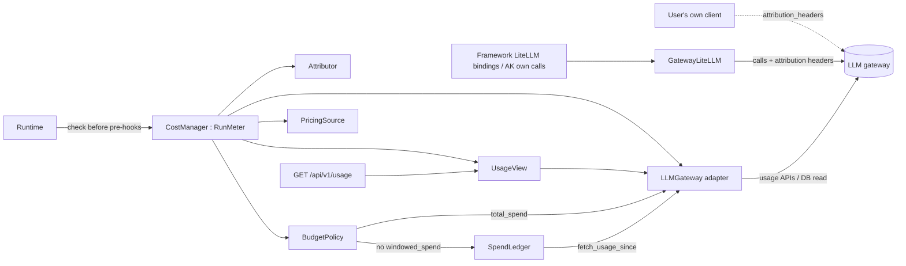

# #954: Pluggable cost management: gateway-backed usage, attribution and user budgets

Every supported LLM call goes through one configured external LLM gateway, carrying attribution headers built from trusted
run context. Agent Kernel reads usage and cost back from that gateway when asked, through an adapter that normalises
them, and enforces per-user budgets: natively where the gateway can, and with a pre-run check against gateway spend
where it cannot. The gateway owns request execution, usage capture and persistent records. Agent Kernel owns
attribution, pricing normalisation, budget configuration and orchestration, and reporting.

## Motivation

- #954 makes the gateway the **source of truth** for usage. Agent Kernel keeps no persistent usage store; it caches
  per-user spend aggregates (the spend ledger) only for a gateway that cannot compute them itself.
- Agent Kernel builds no model client. Every adapter wraps a native agent the user built, for example
  `OpenAIModule` at `framework/openai/openai.py:908` and `LangGraphAgent` at `framework/langgraph/langgraph.py:326`. So
  only a client the user configures can reach the gateway.
- Agent Kernel's own LLM calls go straight to the provider through LiteLLM:
  - multimodal: `core/multimodal/hooks.py:73`, `:94`; `core/multimodal/tools.py:78`
  - thread naming: `integration/thread/naming.py:120`
- `Runtime` has no request id: `Runtime.run` (`core/runtime.py:410`) and `Runtime.stream` (`:466`) take only agent,
  session, requests and principal. The id exists only on the envelope (`core/model.py:764`) and is dropped before the
  run (`core/chat_service.py:151`).
- The user identity Agent Kernel can trust is the published principal: `ak.principal` (`core/base.py:32`), which
  application code cannot write.
- `ErrorCategory` (`core/util/error_util.py:1-7`) has no budget category. A gateway's budget refusal would surface as
  `AUTH` or `RATE_LIMIT`.
- Gateway capabilities differ sharply. Only LiteLLM enforces per-user budgets before the request is sent; Agentgateway
  has no HTTP usage API (usage lives in its request-log database); Langfuse has no budgets (`research/gateways.md`).

## Requirements

### Activation and configuration

- A `cost` block in `AKConfig` enables the capability by being present. It is `_CostConfig | None = None`, the
  `thread` / `schedule` / `identity` pattern (`core/config.py:1529`, `:1535`, `:1549`). There is no `enabled` flag.
- With no `cost` block, behaviour is unchanged: no headers, no budget check, the usage route returns 404.
- An invalid or incomplete block raises `AKConfigError` at startup. So does any of the following:
  - a `cost.gateway` without `type` or `base_url`
  - a capability the configured gateway does not declare, needed by the config (for example a `budgets` block on a
    gateway with none of `native_user_budget`, `windowed_spend` or `usage_retrieval`)
  - a budget currency the gateway does not report
  - an Agentgateway gateway without `database`
  - a malformed `budgets.users` key (see Attribution), or the reserved key `ak-system`

```yaml
cost:
  gateway:
    type: litellm                 # litellm | agentgateway | langfuse | dotted path to an LLMGateway
    base_url: http://litellm:4000 # model endpoint the gateway client sends calls to (or AK_COST__GATEWAY__BASE_URL)
    api_key: ""                   # empty -> SecretManager.get(api_key_key)
    api_key_key: LITELLM_API_KEY
    admin_key: ""                 # optional: usage reads and budget sync, where the gateway separates them
    admin_key_key: LITELLM_MASTER_KEY
    database: {url: "", url_key: AGW_DB_URL}  # agentgateway only: its request-log DB (Postgres or SQLite), read-only
    litellm:                      # litellm only
      api: end_user               # end_user | customer_management
      customer_org_alias: ""      # customer_management only: the org every member belongs to
  attribution:
    type: default                 # default | dotted path to an Attributor
  view:
    type: default                 # default | dotted path to a UsageView
  pricing:
    type: passthrough             # passthrough | static | dotted path to a PricingSource
  budgets:
    on_error: block               # block | allow: what a failed budget check does
    default: {amount: 100, currency: USD, period: monthly, action: block}
    users:                        # keys are the attributed user id: <provider>|<namespace>|<subject>, percent-encoded
      "oidc|https%3A%2F%2Fissuer.example|user-123": {amount: 20, currency: USD, period: monthly, action: block}
      "static|static|user-456": {amount: 50, currency: USD, period: monthly, action: warn}
    ledger:                       # used only when the gateway lacks windowed_spend (see Spend ledger)
      type: redis                 # in_memory | redis | valkey | dynamodb | cosmosdb | firestore | dotted path to a SpendLedger
      redis: {url: "redis://redis:6379", prefix: "ak:cost:ledger:"}
```

- New fields, and why none can be derived from existing config:
  - `gateway.type`, `gateway.base_url`: which gateway sits in front of the models is deployment knowledge, and no
    existing block holds a model endpoint (no `base_url` anywhere in `AKConfig`)
  - `gateway.api_key` / `admin_key` / `database.url` with their `*_key` siblings: the house secret-field shape. The
    value field falls back to `SecretManager.get(<*_key>)` when empty, at the point of use, never inside `AKConfig`.
    The request's `${VAR}` YAML form is not supported: AK config has no `${}` interpolation (only `<file:...>`,
    `core/util/config_yaml_util.py:39`); environment values arrive through `AK_COST__*` variables
  - `gateway.litellm.api`: LiteLLM has two incompatible per-user APIs (see LLM gateway); which one the proxy runs
    is deployment knowledge
  - `gateway.litellm.customer_org_alias`: Customer Management scopes members to an organization; nothing in config
    names it
  - `attribution.type`, `pricing.type`, `view.type`: name the bring-your-own (BYO) class
  - `pricing.static`: per-model rates; nothing in config holds a price
  - `budgets.*`: budget amounts are new data
  - `budgets.on_error`: the explicit failure policy the requirements demand (§10)
  - `budgets.ledger`: where budget spend aggregates live when the gateway cannot aggregate them. It mirrors
    `_ThreadStoreConfig` (`core/config.py:489`): `type` (default `in_memory`) plus per-backend blocks reusing
    `_RedisConfig`, `_ValkeyConfig`, `_DynamoDBConfig`, `_CosmosDBConfig`, `_FirestoreConfig` (`core/config.py:23-60`).
    Ignored with a warning on a gateway with `windowed_spend`; missing where needed means `in_memory` with a warning
- Dotted-path classes receive their sub-block (`extra="allow"`, the identity-provider pattern).

### LLM gateway (`LLMGateway`)

- An ABC in `agentkernel/cost/gateway/`. It is the only place a gateway is named. `Runtime`, `CostManager`, the
  budget policy and the usage route all talk to the ABC.
- `capabilities: GatewayCapabilities` is a class-level declaration (the `SandboxCapabilities` pattern). Every
  consumer reads it before calling an optional operation. The flags:
  - `usage_retrieval`
  - `cost_retrieval`
  - `user_aggregation`
  - `windowed_spend`: per-model sums for one user over an arbitrary UTC window, in one aggregate read
  - `agent_aggregation`
  - `session_filter`
  - `custom_metadata`
  - `native_user_budget`
  - `request_level_budget_check` (strict pre-request reservation)
  - `streaming_usage`
  - `currencies`
  - `filters`: the subset of user, agent, session, time range, model and provider it can filter on
- Operations:
  - `attribution_headers(attribution) -> dict[str, str]`, required. Returns the attribution in the gateway's own
    header vocabulary.
  - `fetch_usage(query) -> UsageResult`, needs `usage_retrieval`. Returns records normalised to `ModelUsage`, paging
    through the gateway's API.
    - A filter outside `capabilities.filters` raises `UnsupportedCapabilityError`.
    - Any failure raises `UsageRetrievalError`. It never returns an empty result in place of an error.
    - Hitting a gateway cap raises `UsageTruncatedError`. It never returns a partial total.
  - `total_spend(user_id, window) -> SpendTotal`, needs `windowed_spend`. The aggregate the budget check reads,
    so a user's row count never affects enforcement.
    - `SpendTotal` holds per-model sums: requests, each token kind, `provider_cost`, and the count of unpriced
      requests. That is enough for a `PricingSource` to bill the aggregate (`bill_total`) without rows.
    - A gateway whose own spend figure is lifetime, reset on the gateway's schedule, or not per model does not
      declare `windowed_spend`.
  - `fetch_usage_since(user_id, cursor) -> (rows, next_cursor)`, needs `usage_retrieval`. The incremental read the
    spend ledger uses: rows strictly after `cursor` (gateway timestamp plus row id), in that order, so no row is
    skipped or repeated.
  - The fallback budget check uses `total_spend` when `windowed_spend` is declared, otherwise the spend ledger.
  - `sync_budgets(budgets)`, needs `native_user_budget`. Writes per-user budgets into the gateway.
  - `is_budget_refusal(error) -> bool`, required. Matches the gateway's error type or code, never the HTTP status
    alone.
- Built-ins, behind the `cost` extra (gateway SDK-free: `httpx` plus `litellm`):

  | | `litellm` (`api: end_user`) | `litellm` (`api: customer_management`) | `agentgateway` 1.7.x | `langfuse` |
  |---|---|---|---|---|
  | User header | `x-litellm-customer-id` (first in its end-user resolution order) | `x-litellm-customer-org-alias` + `x-litellm-customer-member-id` | `x-ak-user-id` | `langfuse-user-id` |
  | Agent / session / request | `x-litellm-tags` (agent); session and request id in `x-litellm-spend-logs-metadata` | as `end_user` | `x-ak-agent-id`, `x-ak-session-id`, `x-ak-request-id` | `langfuse-tags` (agent), `langfuse-session-id`, `langfuse-metadata` (`request_id:<id>`) |
  | `fetch_usage` | `/spend/logs/v2` filtered on `end_user` (never `user_id`, LiteLLM's internal user); agent and session grouped or filtered client-side from `request_tags` and `metadata` | daily totals only (`/management/v1/customer_members/daily/activity`); per-member row retrieval **not available** | read-only SQL on `request_logs` | `/api/public/v2/observations` filtered by `userId` / `sessionId` |
  | `total_spend` (`windowed_spend`) | no: `/customer/info` `spend` is lifetime (or LiteLLM's reset period when a budget is attached) and not per model | no: member `spend` has the same limits | yes: SQL `SUM ... GROUP BY model` over the window | yes: v2 metrics filtered by `userId`, grouped by model (never top-N user grouping) |
  | Fallback budget source | spend ledger, fed by `fetch_usage_since` over `/spend/logs/v2` filtered on `end_user`, ordered by `startTime`; cursor = last settled `startTime` + `request_id` | not available: no per-member rows, so no ledger and no other fallback; a fallback budget raises `AKConfigError`; native budgets unaffected | `total_spend` | `total_spend` |
  | `native_user_budget` | yes: `/customer/new` / `/customer/update` with a `budget_id` | yes: `/management/v1/customer_members/upsert` with a budget | no: budgets are per API key only | no |
  | Default budget | a `/budget/new` row; Agent Kernel sets `litellm_settings.max_end_user_budget_id` to it through the admin API | the org's default budget template (`/customer_organizations/{id}/default_budgets`) | fallback | fallback |
  | `request_level_budget_check` | yes: reservation (on by default) | yes | n/a | n/a |
  | Refusal signature | `error.type` / `litellm_error_type` = `budget_exceeded` (422 by default on current releases; 429 on 1.95.x); never matched by status | as `end_user` | `budget_exceeded` (429) | n/a |
  | Setup the operator owns | DB-backed proxy; `always_include_stream_usage`. (`max_end_user_budget_id` is set by Agent Kernel; `timezone` and `budget_reset_time` are validated by it, see Budgets) | as `end_user`, plus the organization | CEL `standardAttributes` over the `x-ak-*` headers (below); a request-log database | a **service-account** key, without which `langfuse-user-id` is ignored (documented) |

  - LiteLLM `customer_management`:
    - Needs LiteLLM 1.111 or later. On 2026-11-17 that is prerelease only; the latest stable is 1.109.1. The adapter
      reads the proxy version at startup and raises `AKConfigError` below 1.111.
    - Without LiteLLM Enterprise it is capped at 5 organizations, 5 teams per organization and 5 members per team.
      Per-user budgets for more users need Enterprise. Documented.
    - `end_user` is the default: open source, in every stable release including the locked 1.95.x.
    - Per-member spend rows are not available: `fetch_usage_since` is not declared and nothing replaces it. Only
      native budgets work in this mode. Documented.
  - Agentgateway 1.7.x:
    - Its database comes from `config.logging.database.url`, falling back to `config.database.url`: Postgres
      (`postgres://` URLs) or SQLite.
    - Schema pinned: at startup the adapter reads `_agentgateway_request_log_migrations` and accepts only the
      migration versions 1.7.x ships (Postgres 1–3 from the source tree; SQLite 1–2, observed on a v1.7.0 run). Any
      other version raises `AKConfigError`.
    - Columns read from `request_logs`: `started_at`, `agentgateway_user`, `agentgateway_group` (agent),
      `gen_ai_provider_name`, `gen_ai_request_model` / `gen_ai_response_model`, `input_tokens`, `output_tokens`,
      `cache_read_input_tokens`, `cost`.
    - Session and request id are not columns. They are read from `attributes_json` (verified on a real v1.7.0 row,
      `research/agentgateway-session-attribute.md`):
      - session: the `agentgateway.session` key, from `standardAttributes.session`
      - request id: the `ak.request_id` key, added by `frontendPolicies.accessLog.database.add`
      - a missing header leaves the key (or the `agentgateway_group` column) absent or `NULL`, read as `None`
    - Documented operator config:
      ```yaml
      config:
        standardAttributes:
          user: request.headers["x-ak-user-id"]
          group: request.headers["x-ak-agent-id"]
          session: request.headers["x-ak-session-id"]
      ```
    - SQLite through stdlib `sqlite3`. `ak-py/uv.lock` locks no Postgres driver, so Postgres goes behind its own
      extra (`cost-agentgateway`) with `require_extra`.
    - Agentgateway prices an uncatalogued model at $0, which looks the same as free spend. Documented.
  - Langfuse:
    - A full built-in, built against self-hosted Langfuse 4.75.0 or later with the gateway image on the same version
      (or Langfuse Cloud). The vendor labels the gateway beta; a compatibility suite pins the header and route
      contract the adapter depends on.
    - OpenAI and Anthropic formats are served on separate bases (`/openai/v1`, `/anthropic/v1`) without translation
      between them. The adapter derives the base from the model's provider.
    - Header limits: 1 KiB per value and 8 KiB in total, beyond which Langfuse drops every context header. The adapter
      checks both before sending and raises rather than send attribution that would be silently dropped.
    - `langfuse-metadata` is comma-separated `key:value` pairs, not JSON.
- `LLMGatewayFactory` follows the `core/util/factory.py` shape: `if/elif` built-ins, `require_extra`, `resolve_dotted`
  for BYO, `AKConfigError` otherwise.
- `LLMGatewayContract` (`cost/testing.py`) checks every built-in against its declaration:
  - an undeclared operation raises `UnsupportedCapabilityError`
  - a failed fetch raises, and never comes back as zero
  - pages are concatenated in order
  - headers overwrite a caller's value for the same key

### Gateway client and request coverage

- `GatewayLiteLLM` (class, `cost/client.py`) is Agent Kernel's gateway-bound LiteLLM client. `completion` and
  `acompletion` call LiteLLM with:
  - `api_base` set to the gateway (Langfuse: the base for the model's provider)
  - `api_key` resolved through `SecretManager`
  - `extra_headers` = the caller's headers with the current run's attribution headers merged on top, so Agent
    Kernel's keys win
  - `stream_options.include_usage` set for OpenAI-format streams
- Headers are computed **per call** from the current context: `Session.current()`, its published principal,
  `Agent.current()` and the run's request id. Never from a global: `litellm.headers` is a module-level setting shared
  by concurrent runs, so Agent Kernel never sets it.
- A call outside any run (thread naming in `ThreadRecorder.pre_run`, which runs before `Runtime`) sends the
  attribution the caller passes explicitly (`GatewayLiteLLM.completion(..., attribution=...)`). Thread naming passes
  the principal and session id it already holds. With neither, the call is sent with `user_id=ak-system` and no agent.
  - `ak-system` is never refused: native budget sync always upserts it with no budget (LiteLLM: a customer with no
    `budget_id`, so `max_end_user_budget_id` never applies), and the fallback check skips it.
  - `ak-system` is reserved: the default attributor cannot produce it (its ids are `anonymous` or contain `|`), and a
    `budgets.users` key equal to it raises `AKConfigError`.
- Framework bindings: thin per-framework classes over each framework's own model seam, so headers are added on
  every call from the current context. Verified at the `uv.lock` versions (`research/framework-bindings.md`):
  - Each lives in `framework/<fw>/cost.py` and is exported from the framework's public module (`agentkernel.<fw>`,
    e.g. `from agentkernel.openai import GatewayLitellmModel`), next to its `*Module`.
  - Dependency direction: `framework/` imports `cost/client.py`; `cost/` never imports `framework/`. The import is
    lazy, so a framework module without the `cost` extra still loads.
  - The user builds the binding in place of the framework's own model class. It takes the model name and reads
    `base_url` and the key from `cost.gateway`. Constructing one without a `cost` block raises `AKConfigError`.

  | Framework | Class the user builds | Binding | Granularity | Context reaches the call |
  |---|---|---|---|---|
  | openai-agents 0.20.0 | `GatewayLitellmModel` | `LitellmModel` subclass overriding `_merge_headers` (`agents/extensions/models/litellm_model.py:890`) | per call | yes (async) |
  | google-adk 2.8.0 | `GatewayLiteLLMClient` (passed as `LiteLlm(llm_client=...)`) | `LiteLLMClient` subclass passed as `LiteLlm(llm_client=...)` (`google/adk/models/lite_llm.py:868`, `:3042`); merges with the request's own `extra_headers` | per call | yes (async) |
  | smolagents 1.26.0 | `GatewayLiteLLMModel` | `LiteLLMModel` subclass overriding `_prepare_completion_kwargs` (`smolagents/models.py:502`) | per call | yes: AK calls `agent.run` via `asyncio.to_thread` (`framework/smolagents/smolagents.py:170`); parallel tools copy context (`smolagents/agents.py:1426`) |
  | crewai 1.15.18 | `GatewayCrewLLM` | `LLM` subclass forcing `is_litellm=True` and overriding `_prepare_completion_params` (`crewai/llm.py:749`) | per call | yes: `kickoff_async` runs `kickoff` via `asyncio.to_thread` (`crewai/crew.py:1160`); async tasks and parallel tools copy context |
  | agent-framework-core 1.24.0 (MAF) | `GatewayChatClient` | `BaseChatClient` subclass implementing `_inner_get_response` over `GatewayLiteLLM` (`agent_framework/_clients.py`) | per call | yes (async; sync tools via `asyncio.to_thread`) |
  | LangChain / LangGraph | `GatewayChatLiteLLM` | `ChatLiteLLM` subclass from the `langchain-litellm` package | per call | yes (per call); covered by the binding's context test |
  | claude-agent-sdk 0.2.179 | none: automatic in `ClaudeModule` when `cost` is configured | the Claude adapter sets `ANTHROPIC_BASE_URL` and `ANTHROPIC_CUSTOM_HEADERS` in `ClaudeAgentOptions.env` (`claude_agent_sdk/types.py:2492`), which is merged over the CLI subprocess environment (`_internal/transport/subprocess_cli.py:819`) | per run: one CLI process per run, so `request_id` identifies the run | n/a |
  | Pydantic AI | none (`CostRunOptions.factory`) | none: `LiteLLMProvider` (`pydantic_ai/providers/litellm.py:34`) wraps an `AsyncOpenAI` client, not the LiteLLM SDK | per run | run-options path below |

  - CrewAI caveats, documented:
    - Without `is_litellm=True`, `LLM.__new__` hands a native-provider model back instead of the subclass
      (`crewai/llm.py:394-517`), so the binding forces it.
    - `LLM.__copy__` rebuilds a plain `LLM` (`crewai/llm.py:2561`). Only `train` and `kickoff_for_each` copy agents,
      and Agent Kernel calls neither.
    - Sync tools run via `run_in_executor` without copying context (`crewai/tools/structured_tool.py:410`), so a
      tool's own LLM call there must pass attribution explicitly.
  - LangChain: the binding is `GatewayChatLiteLLM` over `ChatLiteLLM`. `ChatLiteLLM` is no longer in
    `langchain-community` 0.4.2, and `langchain-litellm` is not locked, so the binding adds it as an optional
    dependency of the `langgraph` extra. Using it is the user's choice, as with every binding.
  - Claude Agent SDK: gateway routing supports **API-key authentication only**. A Claude subscription or OAuth login
    is not routed through the gateway and is outside the tracked path. With `cost` configured and no API key, the
    Claude adapter raises `AKConfigError` when the agent is built. Documented.
  - LiteLLM itself keeps context: `acompletion` runs `completion` in an executor inside `copy_context()`
    (`litellm/main.py:647`).
- Users who bring their own client have two per-run routes. `default_headers` fixed when a client is built cannot
  carry per-run values, so neither uses them:
  - a #758 `run_options` factory that returns `CostManager.attribution_headers()` into the framework's native per-run
    field: OpenAI `ModelSettings.extra_headers`, Pydantic AI `model_settings.extra_headers`, ADK
    `RunConfig.http_options`. Agent Kernel ships a ready-made `CostRunOptions.factory` for these three.
  - a tool's own client calls `CostManager.attribution_headers()` and passes them per request.
  
  `attribution_headers()` returns the current run's headers and raises `RuntimeError` outside a run.
- **Coverage rule**: when cost management is on, every LLM call must either use `GatewayLiteLLM` (directly or through a
  framework binding) or send `attribution_headers()` to the gateway itself.
  - This goes into the user docs (`docs/docs/`), into the bundled agent-creation skills
    (`ak-py/src/agentkernel/skills/ak-build`, `ak-add-capabilities`), and into each example that uses cost management.
  - A call that bypasses the gateway is not in its records. A call that reaches the gateway without headers is
    recorded unattributed. Both are documented as outside the tracked path.
- Agent Kernel's own LiteLLM calls (multimodal description and analysis, thread naming) use `GatewayLiteLLM` when
  `cost` is configured, and unchanged `litellm` otherwise.
- Outside the tracked path, documented:
  - Bedrock and Walled AI guardrails (their own SDKs)
  - OpenAI guardrails (unless spec stage confirms its client takes a base URL and headers)
  - realtime sessions (native SDK websockets)
  - Claude Agent SDK runs authenticated by subscription or OAuth instead of an API key
  - test evaluators

### Attribution

- `Attributor` ABC: `resolve(ctx) -> Attribution(user_id, agent_id, session_id, request_id)`.
- Default `Attributor`:
  - `user_id` comes **only** from the run's published principal.
    - Default form: `<provider>|<namespace>|<subject>`, each part percent-encoded. This keeps the same subject under
      two issuers as two users.
    - `namespace` is `None` only for the anonymous principal (`core/model.py:403`), which maps to `anonymous` below,
      so every other id has three non-empty segments.
    - This form is the `budgets.users` key. Keys are validated at startup (`anonymous`, or three non-empty
      segments with valid percent-encoding); a malformed key raises `AKConfigError`. The usage API returns the caller's `user_id`, which is how an operator
      finds a user's key. Documented.
    - Anonymous runs map to `anonymous`, so a budget on it caps all anonymous traffic together. Documented.
    - Shared-channel principals (`messaging:*`, `realtime:*`, `core/model.py:423`) stand for everyone in the channel,
      so one budget caps the whole channel. Documented.
  - `agent_id` is `agent.name`, `session_id` is the session id, `request_id` is the run's request id.
- Spoofing protection:
  - Nothing in a client request body or user run options can set or override attribution.
  - `GatewayLiteLLM` and the bindings write Agent Kernel's header keys last.
  - `user_id` in a chat body is already a 400 (identity rule, #603).
- Request id plumbing:
  - `Runtime.run` and `Runtime.stream` gain `request_id: str | None = None`.
  - It is threaded along the path the principal takes: `ChatService.execute*` → `AgentHandler.run*` →
    `AgentService.run_multi` / `stream_multi` (`core/service.py:177`).
  - The pipeline passes the id it resolves per message (`pipeline/agent_runner.py:73`).
  - A run arriving without one gets a `uuid4().hex`.
  - It is published under a reserved `ak.` key and read through `session.get_request_id()`.
- BYO `Attributor` via dotted path, for example a tenant-scoped user id taken from a claim.
- `AttributorContract`:
  - stable output for the same context
  - `user_id` never taken from anything but the principal
  - context left unmodified

### Usage model, pricing and currency

- `ModelUsage` (Pydantic) is the normalised record:
  - `user_id`, `agent_id`, `session_id`, `request_id`: each `str | None` (unattributed rows exist)
  - `provider`, `model`
  - `input_tokens`, `output_tokens`, `cached_input_tokens`: `int | None`, so a missing count is `None`, never 0 and
    never estimated
  - `provider_cost`, `billed_cost`: `Decimal | None`
  - `currency`, `timestamp`
- Adapters fill only what the gateway reports. A missing cost stays `None` and is counted in
  `UsageReport.unpriced_requests`.
- `PricingSource` ABC: `bill(usage) -> Decimal | None` gives a record's `billed_cost`, `bill_total(spend_total) ->
  Decimal` bills an aggregate per model, and `bills_at_cost: bool` says whether billed equals provider cost.
  - `provider_cost` always comes from the gateway and is never recomputed.
  - Built-in `passthrough` (the default): billed equals provider, `bills_at_cost = True`.
  - Built-in `static`: per-model rates in USD per 1M tokens for input, output and cached input, plus an optional
    `markup` multiplier. `bills_at_cost` is false whenever a rate or markup is set. Cached input is priced at the
    cached rate, falling back to the input rate, and is never charged twice.
  - BYO via dotted path, for example credits or free tiers.
  - `PricingSourceContract`: `None` in gives `None` out; cached tokens are not double-charged.
- Currency: Agent Kernel does not convert.
  - A budget currency outside `gateway.capabilities.currencies` (USD for all three built-ins) raises `AKConfigError`
    at startup.
  - A record arriving in another currency raises `UsageRetrievalError`. It is never summed.

### Usage retrieval and aggregation

- `UsageView` ABC (§9.5): `report(query, principal) -> UsageReport`. It applies authorization (which queries this
  principal may run), aggregates and shapes the result. Built-in `default`, BYO via dotted path, `UsageViewContract`.
  The default does the following:
  - `UsageQuery` fields: `user_id`, `agent_id`, `session_id`, `start`, `end`, `model`, `provider`.
  - The view calls `gateway.fetch_usage` and aggregates the pages **in memory, per request**. Nothing is persisted:
    no `UsageStore`, no usage rows held by Agent Kernel (the spend ledger holds budget aggregates only).
  - Long windows are split into sub-windows that stay under the gateway's row caps (LiteLLM 10k, Langfuse 1000 per
    page). A cap that is still hit is a `UsageTruncatedError`, never a partial total.
- `UsageReport` has one shape whatever the gateway:
  - `user_id`, `currency`, `window`
  - `total_cost` (billed) and `total_provider_cost`
  - `total_input_tokens`, `total_output_tokens`, `total_cached_input_tokens`
  - `unpriced_requests`
  - `agents`: per-agent cost and tokens
  - `sessions`, only when the query is scoped to one agent or session
- User × agent and user × session are answered by filtering on one dimension and grouping on the other client-side.
  A query the gateway cannot filter becomes a client-side filter over a filterable query (time range plus user).
  Only when even that is impossible is it `UnsupportedCapabilityError`.
- A BYO `UsageView` may change authorization or add fields, but must return the `UsageReport` envelope keys, so
  clients rely on one format. The contract suite asserts the envelope.

### Budgets

- `BudgetPolicy` ABC: `check(ctx, attribution) -> BudgetDecision`, one of `allow`, `warn(message)` or
  `deny(message)`.
  - Built-ins: `static` (the `budgets` block) and `none`, used when there is no `budgets` block.
  - BYO via dotted path.
  - `BudgetPolicyContract`.
- Budget model, `BudgetLimit`:
  - `amount` (> 0), `currency`
  - `period`: `daily` | `weekly` | `monthly`
  - `action`: `block` | `warn`
  - optional `message`
- Resolution: `budgets.users[<user key>]` overrides `budgets.default`. No entry means no budget.
- Periods are calendar-aligned in UTC: the day starts at 00:00, the week on Monday, the month on the 1st. The current
  period's spend is everything timestamped since its start. Documented.
- Compared figure: `pricing.bill_total(total_spend)` against `amount`. With `passthrough` that equals the gateway's
  provider cost.
  - A request with no cost counts as zero toward the amount. `SpendTotal.unpriced_requests` exposes it, a warning is
    logged once per model, and docs say a budget cannot see unpriced spend (the Agentgateway $0 case included).
- **Native enforcement** (preferred):
  - At startup `CostManager` calls `gateway.sync_budgets` for each per-user budget the gateway can express **exactly**:
    - `native_user_budget`
    - `action: block`
    - `pricing.bills_at_cost` (a gateway enforces on its own cost, not `billed_cost`)
    - a period the gateway represents faithfully
  - LiteLLM periods map exactly: `daily` → `1d`, `weekly` → `1w` (resets Monday), `monthly` → `1mo` (resets on the
    1st). These durations are calendar-aligned in LiteLLM's `duration_parser`, against `litellm_settings.timezone`
    (default UTC) and `budget_reset_time`. The proxy must run with UTC and `"00:00"`.
  - Proxy settings, read and written through the LiteLLM admin API (with `admin_key`) during native sync:
    - `max_end_user_budget_id`: **configured** by Agent Kernel to the default budget row it owns; idempotent
    - `timezone` and `budget_reset_time`: **validated**; anything but `UTC` and `"00:00"` raises `AKConfigError`
      naming the setting. Agent Kernel never overwrites them: they are proxy-wide and would move every other
      tenant's resets
    - exact admin routes are pinned in spec.md and recorded in `research/gateways.md`
  - Sync is idempotent (an upsert per user) because every process runs it at startup. A user removed from config is
    not deleted from the gateway: Agent Kernel does not track what it created, and deletion is documented as manual.
  - Startup with the gateway down. Config errors fail fast; availability errors do not:
    - an auth failure (401/403) or a gateway that rejects the budget shape raises `AKConfigError`: the deployment is
      misconfigured, and retrying will not fix it
    - an unreachable gateway or a 5xx logs an error and does not stop startup. The sync retries in the background
      with capped exponential backoff until it succeeds, so a gateway outage never blocks a rollout
    - until a retried sync succeeds, the gateway keeps the budgets from the last successful sync (LiteLLM stores them
      in its database); a budget new in this config is enforced by the fallback check meanwhile
    - startup probes that need the gateway (the LiteLLM `customer_management` version check, the Agentgateway
      migration check) follow the same rule: deferred when unreachable, fatal when they read a wrong answer. Until
      a probe succeeds, usage reads return 502 and budget checks apply `budgets.on_error`
  - Deliberate trade-off, documented: with the default `on_error: block`, a gateway outage denies every run of a user
    with a fallback budget. Model calls would fail in the same outage anyway, since they go through the gateway.
  - A natively synced budget is not checked again by Agent Kernel. Its enforcement and strictness are the gateway's
    (LiteLLM: pre-request reservation).
  - The default budget covers users unknown at startup:
    - `end_user`: Agent Kernel creates (or updates) one `/budget/new` row for it and sets that row's id as
      `litellm_settings.max_end_user_budget_id` (above). Every end user without their own budget then gets a separate
      counter against it. `max_end_user_budget` (a float) is never used: the proxy does not read it.
    - `customer_management`: written as the organization's default budget template.
    - Other gateways: enforced by the fallback check.
- **Fallback enforcement** (every other budget):
  - `Runtime` calls `RunMeter.check(ctx)` **before any pre-hook**, at `core/runtime.py:433` (run) and `:494` (stream).
    An over-budget user spends nothing, not even on guardrail or multimodal calls.
  - `check` reads the current period's `SpendTotal`, from `gateway.total_spend(user, current period)` or from the
    spend ledger (see LLM gateway), and compares it with the budget.
  - `deny`: no model call is made. Non-streamed runs return an `AgentReplyText` with the message, the pre-hook halt
    shape (`core/runtime.py:434-438`). Streamed runs yield one `StreamChunk(error=<message>, done=True)` (`:499`).
  - `warn`: the run proceeds. Agent Kernel logs a warning naming the user, the budget, the period and the spend.
    Nothing is added to the reply or the stream.
  - Default message: "Your usage budget for this period has been reached."
  - A resume is checked like any run. A `deny` (or an `on_error: block` denial) on a resume:
    - leaves the paused run untouched, so it can be answered again once the period resets or the budget changes
    - logs the existing resume-halted warning (`Runtime._warn_resume_halted`, `core/runtime.py:394`), as a pre-hook
      halt does (`:437`, `:498`)
    - returns the same deny shape as a fresh run
- Gateway refusals mid-run: `ErrorUtil` asks `RunMeter.is_budget_refusal(error)` first and maps a match to the new
  `ErrorCategory.BUDGET`, whose user-facing message is "The usage budget for this request has been reached." Without
  a `cost` block nothing matches, and categories are unchanged.
  - Frameworks re-raise their own exceptions around LiteLLM's (openai-agents, CrewAI, LangChain). The check walks the
    `__cause__` / `__context__` chain, cycle-safe, and matches on any link. Each adapter's `is_budget_refusal`
    still inspects only one exception; the walk lives once in `RunMeter`.
- Consistency, declared rather than claimed:
  - Strict only when the gateway reserves before the request (`request_level_budget_check`: LiteLLM native).
  - The fallback is best-effort and documented as such:
    - concurrent runs can all pass before any spend is recorded
    - gateway writes lag (LiteLLM batches spend writes; Langfuse records best-effort)
    - in-flight runs are not counted
    - a run that starts under budget completes
  - Docs name the gateway and setting needed for strict enforcement.
- Cost on the hot path, per run of a user with a fallback budget:
  - `windowed_spend` gateways: one aggregate read (one SQL `SUM`, one metrics query), whatever the user's row count.
  - ledger gateways: one incremental row read (only rows since the cursor), one ledger write and one ledger read.
- Failure policy: `budgets.on_error` applies when `total_spend`, `fetch_usage_since` or the ledger fails, or the
  gateway is unreachable.
  - `block` (default) denies the run with a distinct "budget could not be verified" message.
  - `allow` runs it and logs at warning level.
  - A retrieval failure is never read as zero spend.
- Budgets come from config only. There is no write API (see Non-goals).

### Spend ledger (`SpendLedger`)

- Per-user, per-period, per-model spend aggregates for a gateway without `windowed_spend`. A **derived cache**:
  filled only from gateway rows, rebuildable from the gateway, never the source of truth, and never holding rows.
- Records:
  - aggregate, keyed `(user_id, period, period_start, model)`: `requests`, `input_tokens`, `output_tokens`,
    `cached_input_tokens`, `provider_cost`, `unpriced_requests`
  - cursor, keyed `user_id`: the last gateway timestamp and row id applied
- `SpendLedger` ABC (`cost/ledger/`):
  - `cursor(user_id)`
  - `add(user_id, rows, expected_cursor, next_cursor)`: adds the rows' deltas and advances the cursor
    **atomically**, compare-and-set on `expected_cursor`. A stale cursor adds nothing, so two processes pulling the
    same rows never double-count.
  - `read(user_id, period, period_start) -> SpendTotal`
- Check flow: `cursor` → `gateway.fetch_usage_since` → `add` → `read` → `pricing.bill_total`.
  - Late rows: a fixed `settle_lag` of 10 minutes (documented, not a config field) covers LiteLLM's batched spend
    writes. The settle line is `now − settle_lag`.
    - rows before the settle line are **settled**: `add` stores them, and the cursor never moves past the settle line
    - rows after it are **unsettled**: re-read on every check, added to that check's total only, never stored. A row
      written late but inside the lag is still counted
    - a row older than the settle line that arrives after the cursor has passed it is missed; documented as
      best-effort, like the rest of the fallback
    - cost: each check re-reads at most the last 10 minutes of the user's rows
  - A user with no cursor starts at the start of the longest configured period, so the first check sees the whole
    current period.
  - A compare-and-set conflict re-reads the cursor and retries once, then applies `budgets.on_error`.
- Each row is bucketed by its timestamp into every period kind (`daily`, `weekly`, `monthly`) used by a budget.
- Retention: an aggregate expires one period after its period ends (native TTL where the backend has one).
- Failure: a ledger read or write failure is a budget-check failure (`budgets.on_error`), never read as zero.
- Backends, each over the shared driver in `core/util/driver/`, the way the thread store uses them
  (`integration/thread/store/`):
  - `in_memory`: single process only, documented as dev and test use
  - `redis`, `valkey`: one base over `_RedisLikeDriver` (`core/util/driver/redis_like.py`)
  - `dynamodb`, `cosmosdb`, `firestore`
  - BYO via dotted path
- `SpendLedgerFactory` follows the `core/util/factory.py` shape; `SpendLedgerContract` lives in `cost/testing.py`.

### Streaming

- Agent Kernel never reads usage from a model response, so streamed and non-streamed calls are counted the same way:
  by the gateway's own record.
- Per gateway:
  - LiteLLM records stream usage when `always_include_stream_usage` is set (documented setup).
  - Agentgateway and Langfuse record stream usage per their docs. `GatewayLiteLLM` requesting `include_usage` (below)
    covers the case where they do not inject it themselves.
  - `GatewayLiteLLM` always requests `include_usage` on OpenAI-format streams.
- `capabilities.streaming_usage` is declared per adapter, and docs state the gaps.

### Usage REST API

- `UsageRESTRequestHandler` (extends `AuthorisedRESTRequestHandler`, `api/handler.py:44`) serves
  `GET /api/v1/usage?agent_id=&session_id=&start=&end=&model=&provider=` and returns a `UsageReport`.
- Window:
  - `start` and `end` are ISO 8601 timestamps; one without a timezone is read as UTC.
  - Defaults: `end` = now, `start` = the start of the current UTC calendar month.
  - The window may span at most 93 days (a quarter), a fixed limit and not a config field: it bounds how many
    gateway calls one request can fan out to when windows are split under row caps.
  - `start` after `end`, or a window over the limit: 400, naming the parameter.
- It always reports the caller's own usage (`user_id` from the principal).
  - A `user_id` parameter naming someone else is a 403 until #603's authorization phase.
  - Anonymous callers get the inherited 401.
- Statuses:
  - unsupported filter, bad timestamp, inverted or over-long window: 400, naming the parameter
  - truncation: 422
  - gateway or retrieval failure: 502
  - no `cost` block: 404
  
  None of these is ever a 200 with zero totals.
- Mounted by the application, the schedule/thread convention:
  `RESTAPI.run(handlers=[AgentRESTRequestHandler(), UsageRESTRequestHandler()])`.
- Exported lazily from `agentkernel.cost`. It is the package's only FastAPI-importing module, so runner processes
  never load it.

### Wiring

- `CostManager`, a process-wide singleton:
  - `get()` returns `None` without a `cost` block; `reset()` for tests.
  - It owns the gateway, attributor, pricing source, budget policy and `UsageView`.
  - It syncs native budgets at startup.
  - It implements `RunMeter`.
- `RunMeter` is an ABC in `core/` with two calls: `check(ctx) -> BudgetDecision` and `is_budget_refusal(error) ->
  bool`.
  - `RunMeterFactory` returns `CostManager` (imported lazily inside the enabled-check) or a no-op meter.
  - Core never imports `cost/` at module scope.
  - No BYO branch: it is not a backend seam.
- Package: `agentkernel/cost/` holding `gateway/` (ABC, factory, built-ins), `ledger/` (ABC, factory, backends), `attribution.py`, `pricing.py`,
  `budget.py`, `view.py`, `client.py`, `manager.py`, `handler.py` and `testing.py`. Contract suites are not
  re-exported (the `secret/testing.py` rule).

| ABC | Factory | Built-ins | Contract suite |
|---|---|---|---|
| `LLMGateway` | `LLMGatewayFactory` | `litellm`, `agentgateway`, `langfuse` | `LLMGatewayContract` |
| `Attributor` | `AttributorFactory` | `default` | `AttributorContract` |
| `PricingSource` | `PricingSourceFactory` | `passthrough`, `static` | `PricingSourceContract` |
| `BudgetPolicy` | `BudgetPolicyFactory` | `none`, `static` | `BudgetPolicyContract` |
| `UsageView` | `UsageViewFactory` | `default` | `UsageViewContract` |
| `SpendLedger` | `SpendLedgerFactory` | `in_memory`, `redis`, `valkey`, `dynamodb`, `cosmosdb`, `firestore` | `SpendLedgerContract` |



### Error handling

| Condition | Behaviour |
|---|---|
| Gateway unreachable on a model call | The framework error surfaces as today (`ErrorUtil`); no retry added |
| Gateway auth failure (bad key) | Model calls: as above. Usage reads: `UsageRetrievalError` → 502. At startup: native budget sync fails with `AKConfigError` |
| Gateway unreachable at startup | Logged; native sync and startup probes retry in the background with backoff; startup continues |
| Budget refusal from the gateway | `ErrorCategory.BUDGET` with its user-facing message |
| Budget check fails (`total_spend`, `fetch_usage_since` or ledger error) | `budgets.on_error`: `block` denies with a distinct message, `allow` runs and warns; never read as zero |
| Ledger cursor conflict | Re-read and retry once, then `budgets.on_error` |
| Usage retrieval fails | `UsageRetrievalError` → 502; never an empty report |
| Missing records / unattributed rows | Excluded from user-scoped queries; counted only in unscoped admin views (none in #954) |
| Missing cost on a record | `provider_cost` / `billed_cost` stay `None`; `unpriced_requests` incremented |
| Unsupported capability or filter | Startup `AKConfigError` when config needs it; run time `UnsupportedCapabilityError` → 400 |
| Invalid pricing config | `AKConfigError` at startup |
| Currency mismatch | `AKConfigError` at startup; `UsageRetrievalError` at run time |
| Incomplete streaming usage | The gateway's record is used as-is; tokens `None` where not reported |

### Security

- Attribution comes only from the published principal and run context (see Attribution). Clients cannot spoof it.
- Gateway credentials are resolved through `SecretManager` by key name, never held as values in config.
  - They never appear in logs, exceptions or API responses: the adapters log the endpoint path only.
- The admin key is used only for usage reads and native budget sync. Model calls use `api_key`.
- The Agentgateway DB connection is read-only, documented with a read-only database role.
- Users read only their own usage; no cross-user reads until #603.
- Budgets are set in config only; there is no runtime path that modifies them.

### Testing

- Gateway adapters: each built-in subclasses `LLMGatewayContract`.
  - LiteLLM in both `api` modes, with `httpx.MockTransport`; `customer_management` refused below 1.111, and a
    fallback budget in that mode refused.
    - admin settings: `max_end_user_budget_id` written idempotently; a non-UTC `timezone` or a non-`"00:00"`
      `budget_reset_time` refused
    - compatibility test against a real DB-backed LiteLLM proxy (Docker): `/spend/logs/v2` `startTime` order is
      stable, `request_id` is present and unique per row, and a call's spend row appears within `settle_lag` under
      default batch settings
  - Agentgateway: an SQLite fixture built from the 1.7.x migrations, with rows shaped like the observed v1.7.0 row
    (session and request id in `attributes_json`, and a row without them), plus an unknown migration version
    refused at startup.
  - Langfuse: a compatibility suite pinning the header names, the 1 KiB / 8 KiB limits, and the v2 observations and
    metrics request and response shapes.
  - Covered: headers, normalisation, pagination, capability differences, failures (unreachable, 401, 5xx, malformed),
    truncation.
- Client: `GatewayLiteLLM`
  - headers per call from context
  - concurrent runs never see each other's headers
  - caller headers merged with Agent Kernel keys winning
  - `include_usage` on streams
  - one test per framework binding, including context reaching a call made inside `asyncio.to_thread` (CrewAI,
    smolagents)
- Usage and cost:
  - normalisation with missing tokens and cost
  - provider vs billed cost
  - static model pricing
  - cached-token pricing
  - currency mismatch
- Attribution:
  - user, agent and session
  - user × agent aggregation
  - anonymous runs
  - missing or invalid metadata
  - client body or run-option spoofing rejected or overwritten
- Budgets:
  - default and per-user resolution
  - period boundaries (UTC day, week and month edges)
  - block and deny shapes for run and stream; `warn` logs and leaves the reply untouched
  - concurrent checks documented as not strict
  - native sync, including what is excluded and why
  - fallback, via `total_spend` and via the ledger (LiteLLM with a mocked `/spend/logs/v2`)
  - `on_error` with retrieval failure and with ledger failure
  - `ak-system` never refused, natively or by the fallback; the reserved key rejected in config
  - `budgets.users` key validation (`anonymous`, three segments, malformed keys)
- Spend ledger: each backend subclasses `SpendLedgerContract`
  - add then read; period bucketing across day, week and month edges
  - stale cursor adds nothing; concurrent adds never double-count
  - settle lag: a late row inside the lag is counted; the cursor never passes the settle line
  - expiry after the retention window
- API:
  - retrieval and filters
  - 400 / 401 / 403 / 404 / 422 / 502
  - one response format across all three gateways (a shared fixture)
- `Runtime`:
  - `check` runs before pre-hooks and is skipped without a `cost` block
  - `request_id` is threaded and minted
  - a denied resume leaves the paused run answerable and logs the resume-halted warning
  - `ErrorCategory.BUDGET` mapping, including refusals wrapped by each framework's exception
- Startup: auth failure fatal; unreachable gateway logs, retries sync in the background, and does not block startup
- Usage API window: defaults, timezone-less timestamps as UTC, inverted and over-93-day windows rejected
- Framework bindings: each importable from `agentkernel.<fw>`; constructing one without a `cost` block raises
  - Claude: `ANTHROPIC_CUSTOM_HEADERS` value format accepted by the CLI; no API key with `cost` configured raises

## Non-goals

- Building an LLM gateway or proxy.
- Any persistent usage record store in Agent Kernel: no `UsageStore`, no per-request usage rows, no in-process usage
  capture from adapters or responses. The only Agent Kernel-held data is the spend ledger's per-period aggregates,
  used only for gateways without `windowed_spend`, and rebuildable from the gateway.
- Budgets on dimensions other than the user.
- Billing or invoicing.
- Strict enforcement on gateways without pre-request reservation.
- A budget management endpoint or runtime budget writes (a follow-up issue).
- Reading another user's usage, and agent-wide totals across users ("how much has agent X spent?"), over the API.
  Both wait on #603 authorization. Until then, agent-wide totals are a `UsageView.report` call from application code,
  or the gateway's own UI.
- Currency conversion.

## Open questions

- Delivery split. Proposed:
  1. `request_id` plumbing and the `RunMeter` seam
  2. `cost/` core, LiteLLM adapter, client and usage route
  3. budgets and the spend ledger
  4. Agentgateway and Langfuse adapters
  5. docs, skills and examples
