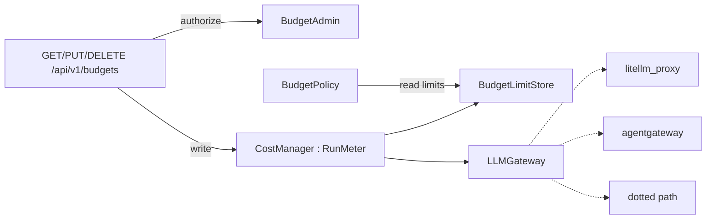

# Parked design: budget management endpoint and LLM gateway mode

Moved out of `../design.md` (#954) on 2026-11-16, when the design was split. This is the reviewed design
text for two follow-up issues (not yet filed), kept so it is not lost. It is **not** a requirement of
#954. Section references such as "see Capture" or "see Recording" point at #954's `design.md`.

## Decisions already taken

- Two follow-up issues: (a) budget management endpoint, (b) LLM gateway mode
- Gateway: `litellm_proxy` ships first; `agentgateway` follows later as a built-in
- `BudgetAdmin`'s `role` built-in waits for #603's authorization phase
- Gateway pricing differences: documented as a limitation; AK does not synchronise price maps with a gateway
- Every unconfirmed external behaviour is verified against the locked versions before a spec is written

## Budget management endpoint

- `BudgetRESTRequestHandler` (extends `AuthorisedRESTRequestHandler`) manages per-value limits in the `BudgetLimitStore`:
  - `GET /api/v1/budgets?dimension=&value=`: the effective limits (stored overrides merged over config defaults) and which of them are stored
  - `PUT /api/v1/budgets?dimension=&value=`: replace the stored limits for that value; body is a list of `BudgetLimit` (`amount`, `unit`, `window`, `action`, optional `message`) — the config entry without `dimension`, which the query supplies
  - `DELETE /api/v1/budgets?dimension=&value=`: remove the stored limits; the config defaults apply again
  - `value` is a query parameter, not a path segment: an OIDC principal key holds the issuer URL, whose `/` a path segment cannot carry; same addressing as `GET /api/v1/usage`
  - Mounted by the application (the schedule/thread convention); 404 when no `cost.budget` block, or when the budget policy is not `static`
- Not every caller may set budgets: every request passes through a `BudgetAdmin` before the store is touched
  - `BudgetAdmin` ABC: `authorize(principal, change: BudgetChange) -> BudgetAdminDecision` (`allow` | `deny(status, message)`)
    - `BudgetChange`: `action` (`read` | `write` | `delete`), `dimension`, `value`, `limits` (the request body for `write`, else `None`)
    - One method carries both authorization (may this principal change this key?) and validation (are these limits acceptable, e.g. a ceiling on `amount`, only some windows allowed)
  - Built-in `role`: allows `read` / `write` / `delete` when the principal holds a configured role (default `cost-admin`), taken from `Principal.roles` (`core/model.py:454`, produced by the identity `RoleMapper`, `identity/provider/roles.py:18`); also allows a principal to `read` its own `principal` key
  - BYO via dotted path: the developer building on Agent Kernel writes the rule (tenant admins manage their tenant's users only, a support tool may only lower limits, ...)
  - `role` would be the first place a role is enforced: roles are produced today but nothing checks them until #603's authorization phase — decided: it waits for that phase
  - When #603's authorization phase lands, a built-in `BudgetAdmin` over its policy model is added beside `role` — the ABC does not change
  - No `admin` block → only self-`read` is allowed; every `write` / `delete` gets 403 — budgets are never settable by default
  - A denial returns the decision's status (403 for not allowed, 422 for invalid limits) and message; the store is untouched
- Body validation of the limit shape itself (types, known units/windows, `amount > 0`) runs before `BudgetAdmin`, on `BudgetLimit` — the model config `limits` entries extend
- `BudgetLimitStore` ABC: `get(dimension, value)`, `put(dimension, value, limits)`, `delete(dimension, value)`; a `BudgetLimitStoreContract` test suite
- Where stored limits live: the gateway when it can hold them, otherwise a separate store
  - A gateway declaring `stores_budgets` is used as the `BudgetLimitStore` for each limit it `supports_limit(dimension, limit)` (e.g. LiteLLM: `principal` + `usd`); the gateway then enforces that limit mid-run with no extra step
    - No `usd` limit goes to the gateway while the pricing source's `bills_at_cost` is `False` (see Budgets)
    - `supports_limit` returns `False` for a window the gateway cannot express exactly; that limit goes to the separate store
    - Only **stored** limits reach the gateway: config defaults apply to every value and are never pushed, so they are enforced at run boundaries only; documented
  - Every other limit goes to the separate store; a single `PUT` may therefore split across both, and `GET` merges them
  - Separate store built-ins: `in_memory`, `redis`, `valkey`, `dynamodb`; default reuses the `cost.store` connection block (no new connection config)
  - When `cost.store` is `gateway` there is no AK backend to reuse: an optional `budget.store` block names the separate store; startup fails fast (`AKConfigError`) when an `admin` block exists and neither a reusable backend nor `budget.store` is configured
  - Write order for a split `PUT` / `DELETE`: separate store first, gateway second — no silent split
    - Separate-store failure: the request fails (502) and the gateway is not called
    - Gateway failure: the separate-store write is restored to its previous limits, then the request fails (502 with the gateway's message)
    - If that restore also fails, both states are logged at error level and the request still fails (502); the next `PUT` / `DELETE` for the key repairs it
- Stored limits are read on every `check`; cached per process for 30 seconds (fixed, no config field), so a change takes effect on every process within 30 seconds
  - The process that served the `PUT` / `DELETE` drops its own cached entry for that key at once
- Every write is logged with the acting principal, the key and the old/new limits (audit)

## Gateway (pluggable proxy mode)

> **Absorbed into #954 on 2026-11-17.** The revised requirements make the gateway the only usage store, so this half now lives in `../design.md`, which changes it substantially: no AK store and no in-process tier. The budget management endpoint above stays parked.

- Two documented tiers, same `cost` block, no separate code path:
  - **In-process (default, no `gateway` block)**: adapters capture, AK prices and records; no infrastructure; enforcement at run boundaries
  - **Gateway mode**: every model call goes through an LLM gateway; what AK delegates to it depends on that gateway's declared capabilities
- `LLMGateway` ABC in `cost/`, selected by `cost.gateway.type`: built-ins `litellm_proxy` and `agentgateway`, dotted-path BYO for any other gateway (e.g. Portkey, Kong AI Gateway, Envoy AI Gateway, an in-house proxy)
  - Core never names a gateway: `CostManager`, the `gateway` store and the budget endpoint talk only to the ABC; `ErrorUtil` (core) talks only to `RunMeter`
  - Reusable `LLMGatewayContract` test suite; every built-in subclasses it
- Required methods:
  - `headers(keys: dict[str, str], request_id: str | None) -> dict[str, str]`: the `Attributor` keys plus the run's request id as headers in the gateway's own vocabulary; header names overridable per key in config
    - The request id ties every gateway spend row to one Agent Kernel request, including calls from a tool's own client; it is a header only — not an attribution key, so it gets no counters
    - Omitted when there is no request id (usage outside a run)
  - `is_budget_refusal(error) -> bool`: recognises the gateway's refusal by error type/code in the body, never by status alone
    - `ErrorUtil` (shared by all eight adapters via `user_facing_error_message`) asks `RunMeter.is_budget_refusal` first and maps a match to the new `ErrorCategory.BUDGET`; `CostManager` delegates to the configured gateway
    - `BUDGET` user-facing message: "Error: The usage budget for this request has been reached."
    - Without a `gateway` block nothing is recognised and a refusal keeps today's category (a 429 stays `RATE_LIMIT`); core holds no gateway signatures
- Optional capabilities, declared as class attributes; config that needs one the gateway lacks fails fast (`AKConfigError`) at startup:
  - `reads_spend` → `totals(queries: list[UsageQuery]) -> list[UsageSummary]` plus `supports_query(dimension, unit) -> bool`, used by the `gateway` store
  - `stores_budgets` → the gateway implements `BudgetLimitStore` plus `supports_limit(dimension, limit) -> bool`; used automatically for the limits it supports (see Budget management endpoint) — no config switch
- Built-ins (from `research/gateways.md`):

  | | `litellm_proxy` | `agentgateway` |
  |---|---|---|
  | `headers` | `principal` → `x-litellm-end-user-id` (its customer budgets); other keys and the request id (`ak_request_id`) → `x-litellm-spend-logs-metadata` (value format unverified — see To verify) | `x-ak-user-id`, `x-ak-agent-id`, `x-ak-session-id`, `x-ak-request-id`; operators key CEL policies and rate limits on them (`request.headers["x-ak-user-id"]`) |
  | `reads_spend` | yes — `/customer/info`, `/spend/logs` (admin key) | no — no per-end-user spend API |
  | `stores_budgets` | yes, `principal` + `usd` only — customer `max_budget` + `budget_duration` | no — budgets are per API key; per-user limits need its rate-limit server (tokens) |
  | refusal signature | `ExceededBudget`, `budget_exceeded` (400/401/422/429) | `budget_exceeded` (429) |
  | mid-run enforcement | customer budgets | per-key budgets; header-keyed token rate limits |

  - The Agentgateway config shapes and the LiteLLM `budget_duration` window format are version-dependent per the research and unverified — see To verify
- Headers are applied by the user through the #758 `run_options` factory with each framework's native field (OpenAI `ModelSettings.extra_headers`, Pydantic AI `extra_headers`, ADK `RunConfig.http_options`)
  - A `current_headers()` accessor on `CostManager` returns the active gateway's headers for the current run, so a tool's own client can add them too
  - Frameworks that fix headers at model construction are documented as gaps, not forced
- What gateway mode adds over in-process:
  - Calls from any client that targets the gateway are seen, including a tool's own model client
  - Hard limits mid-run, which in-process budgets cannot do
- What it does not change, documented:
  - Coverage still depends on every client targeting the gateway: documented setup points SDK clients at it through `OPENAI_BASE_URL` / `ANTHROPIC_BASE_URL`; a client with a hard-coded endpoint bypasses it
  - Attribution still needs the headers on each call, else the gateway records the spend unattributed
  - In-process capture stays on: the reply `usage` / `UsageReport` view is rendered from the run's own entries, because a gateway's per-run figures are not assumed to be available synchronously (LiteLLM spend-log write timing unverified — see To verify)
  - With `store: gateway`, `check` reads totals from the gateway — one HTTP round trip per run on the hot path
- With a gateway lacking `reads_spend` (Agentgateway), AK's own store keeps recording and answering usage queries and budgets; the gateway adds mid-run enforcement on its own policies

## Pieces removed from other sections of #954

### Metering seam

- `RunMeter` gains a fourth call:
  - `is_budget_refusal(error) -> bool`: asked by `ErrorUtil` (see Gateway); the no-op meter returns `False`

### Pricing

  - `PricingSource.bills_at_cost` (class attribute, default `True`; a subclass overriding `bill` sets it `False`): tells the budget and gateway paths whether `billed_cost` equals the provider cost a gateway meters (see Budgets)

### Recording

- Built-in `gateway` store: a `UsageStore` declaring `records = False` (the gateway records itself) that answers `totals` from the configured `LLMGateway` (see Gateway)
  - Fails fast (`AKConfigError`) when the configured gateway does not declare `reads_spend` (e.g. Agentgateway); AK's own store records instead
  - A gateway totals only some dimensions and units (LiteLLM: `principal` in `usd`): startup fails fast for a config limit the gateway's `supports_query` rejects, and the budget and usage endpoints reject such a limit or query (422)
  - A gateway's totals are its own cost figure, not `billed_cost`: startup fails fast (`AKConfigError`) when `store: gateway` is paired with a pricing source whose `bills_at_cost` is `False`
  - A BYO reader over Agentgateway's Prometheus/OTel token metrics is possible as a BYO `LLMGateway` with `reads_spend`, and documented
- `UsageStoreContract` skips its `increment` assertions for a store declaring `records = False` (the `gateway` store)
- The budget endpoint rejects (422) a window longer than the store `ttl`

### Budgets

- `BudgetPolicy.check` also reads the stored limits (cached, see Budget management endpoint)
- `static` limits also come from a `BudgetLimitStore`, written through the budget management endpoint
  - Config limits are the defaults for every value of a dimension; a stored limit targets one value (e.g. `principal=oidc|acme|user-42`)
  - A stored limit replaces the config default with the same `dimension` + `window` + `unit` for that value
  - A gateway enforces on its own cost figure, so a `usd` limit is pushed to a gateway only while the pricing source `bills_at_cost`; otherwise it stays in the separate store and is enforced at run boundaries on `billed_cost`
    - That removes the markup case only: a gateway prices from its own price map, so its figure can still differ from AK's `provider_cost` (with `static` pricing, or whenever the two maps differ)
    - Documented: a gateway-held `usd` limit is counted in the gateway's figure; with `store: gateway` AK's own `check` reads that same figure, with an AK store the two meters can disagree by the price difference

### Wiring

- `CostManager` also owns the budget limit store and `BudgetAdmin` (when a `budget` block exists) and the `LLMGateway` (when a `gateway` block exists)
- The budget endpoint asks `BudgetAdmin`, then writes through `CostManager`, which routes each limit to the gateway or the separate `BudgetLimitStore`
- A `current_headers()` accessor reads the run's request id through `session.get_request_id()` (plumbed in #954)

  | ABC | Factory | Built-ins | Contract suite |
  |---|---|---|---|
  | `BudgetLimitStore` | `BudgetLimitStoreFactory` | `in_memory`, `redis`, `valkey`, `dynamodb` | `BudgetLimitStoreContract` |
  | `BudgetAdmin` | `BudgetAdminFactory` | `role` | `BudgetAdminContract` |
  | `LLMGateway` | `LLMGatewayFactory` | `litellm_proxy`, `agentgateway` | `LLMGatewayContract` |
  | `UsageStore` (addition) | `UsageStoreFactory` | `gateway` | `UsageStoreContract` |

### Configuration

```yaml
cost:
  store:
    type: gateway            # added to: in_memory | redis | valkey | dynamodb | dotted path
  budget:
    admin:                   # absent = nobody can set budgets through the endpoint
      type: role             # role | dotted path (your authorization + validation rule)
      role: cost-admin
    store:                   # optional; default reuses the cost.store connection
      type: redis            # in_memory | redis | valkey | dynamodb | dotted path
  gateway:                   # absent = in-process only
    type: litellm_proxy      # litellm_proxy | agentgateway | dotted path
    url: http://litellm:4000 # only needed for reads_spend / stores_budgets
    admin_key: ...           # secret-resolved like other credentials
    headers: {principal: x-ak-user-id, agent: x-ak-agent-id, session: x-ak-session-id, request_id: x-ak-request-id}  # overrides the gateway's defaults
```

- New fields and why each cannot be derived from existing config:
  - `budget.admin.type`, `budget.admin.role`: the `identity` block produces roles but grants nothing; who may write a budget has no existing home
  - `budget.store`: only needed when `cost.store` is `gateway`, which leaves no AK connection to reuse; reuses the `_RedisConfig` / `_ValkeyConfig` / `_DynamoDBConfig` shapes
  - `gateway.type`: which gateway sits in front of the models is deployment knowledge AK cannot see
  - `gateway.url`, `gateway.admin_key`: the gateway's admin API, distinct from the model endpoint the frameworks use
  - `gateway.headers`: only to override a gateway's default header names

### Diagram edges



## Choices still to confirm

- Budget routes address the key by query parameters, not path segments
- The stored-limit cache is a fixed 30 seconds
- `PricingSource.bills_at_cost` keeps `usd` limits and `store: gateway` away from a gateway whenever `bill` is overridden

## To verify against the locked versions before a spec is written

- LiteLLM Proxy: the `x-litellm-spend-logs-metadata` value format, the `budget_duration` window format, and spend-log write timing
- Agentgateway config shapes (they differ between standalone and Kubernetes, and across versions)
- Per-run header fields for langgraph, maf, crewai, smolagents and claude (`framework-usage.md`: not verified)
