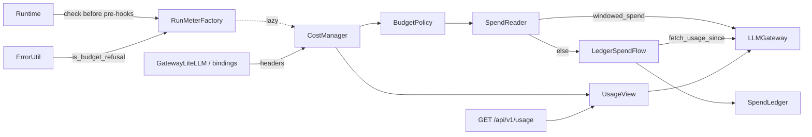

# #954: Pluggable cost management: gateway-backed usage, attribution and user budgets: Implementation Spec

Every supported LLM call goes through one configured LLM gateway and carries attribution headers built from the
run's trusted context. Agent Kernel reads usage back from the gateway through an `LLMGateway` adapter, enforces
per-user budgets natively where the gateway can, and with a pre-run check where it cannot, and serves the caller's
own usage on `GET /api/v1/usage`. The requirements are [`design.md`](design.md). This document says how they are
built. Section numbers (§n) refer to this document.

Citations are against `develop` at `cca1d5f2` (this branch changes only `docs/specs/`), verified on 2026-11-17. External claims name the version they were
checked at: LiteLLM 1.95.1 (the `uv.lock` pin, read in `ak-py/.venv`), the framework versions in
`research/framework-bindings.md`, and Agentgateway v1.7.0 (`research/agentgateway-session-attribute.md`). A claim
not checked in source is marked **unverified**, and the test that pins it is named.

## Deviations from design.md

Found while detailing, and decided by the requester on 2026-11-17. `design.md` is updated to match.

1. **`user_id` is `principal.subject`**, not `<provider>|<namespace>|<subject>`. `budgets.users` keys are plain
   subjects. The same subject under two issuers is one user. A deployment with several issuers uses a BYO
   `Attributor` (§9).
2. **`ak-system` only at named system sites.** Thread naming with no principal is the only built-in caller that
   sends it. Any other `GatewayLiteLLM` call with no run context and no explicit attribution logs a warning and is
   sent unattributed. The requested bind-time capture for `AnalyzeAttachmentsTool` does **not** apply: system tools
   are built once per agent at module load (`core/tool.py:310`, `framework/langgraph/langgraph.py:1146`,
   `framework/adk/adk.py:1160`), so a captured attribution would bill the first run's user for every later call. The
   tool reads the current run's attribution at call time instead. Under CrewAI's context-dropping sync executor it is
   sent unattributed with the warning, which is a documented gap (§8.2).
3. **Thread naming is attributed and runs before the budget check.** `ThreadRecorder.pre_run` passes an
   `Attribution` down to the naming call (§8.3). This is the one documented exception to "an over-budget user spends
   nothing": an over-budget user still pays for one naming call per new thread.
4. **The spoofing rule covers `user_id` and `agent_id` only.** `request_id` keeps the client or pipeline id: it is a
   correlation id, not a budget key. It is minted when absent (§3.1).
5. **`CostRunOptions.wrap(user_factory=None)`**, not a standalone `CostRunOptions.factory`. An agent holds one
   run-options factory (`core/module.py:124`), and a factory key replaces a whole native field
   (`core/base.py:686`), so cost composes with the user's factory instead of replacing it (§7.8).
6. **LiteLLM default budget: lazy per-user upsert.** At LiteLLM 1.95.1, `max_end_user_budget_id` written through
   `POST /config/update` is stored but never applied. The proxy applies only the settings in
   `LITELLM_SETTINGS_SAFE_DB_OVERRIDES` (`litellm/constants.py:1586`; applied at `proxy/proxy_server.py:5669-5674`),
   and that setting is not among them. Agent Kernel instead upserts the default budget onto each user the first
   time that process sees them (§11.4). `max_end_user_budget_id` is never touched.
7. **LiteLLM `timezone` is an operator requirement, not validated.** No admin route returns it at 1.95.1
   (`/get/config/callbacks`, `proxy_server.py:14992`, returns callbacks, alerts and router settings only), and
   `budget_reset_time` does not exist there (`get_next_standardized_reset_time`,
   `litellm_core_utils/duration_parser.py:97`, takes no reset time). The docs require `timezone: UTC` (the default),
   and startup logs once that it cannot be verified (§11.4).
8. **LiteLLM `weekly` maps to `7d`, not `1w`.** At 1.95.1 the calendar alignment lives in
   `get_next_standardized_reset_time`. It aligns `1d` to midnight, `7d` to Monday and `30d` to the 1st (`:190-207`), and
   `mo` to the 1st (`_handle_month_reset`, `:357`). A `w` unit falls through to "next midnight" (`:143`). So `daily`
   maps to `1d`, `weekly` to `7d` and `monthly` to `1mo`.
9. **OpenAI guardrails join the tracked path.** `GuardrailsOpenAI` forwards `**openai_kwargs` to `OpenAI.__init__`
   (`guardrails/client.py:314`, `:324`, `:337`) and `chat.completions.create(**kwargs)` to the OpenAI client
   (`guardrails/resources/chat/chat.py:67`, `:93`). So it takes a base URL at construction and `extra_headers` per
   call (§8.4). The guardrail checks' own LLM calls inside the library are **unverified**, and are documented as
   possibly unattributed.
10. **Spend-ledger cursor holds the row ids at its timestamp.** `/spend/logs/v2` sorts on one column only
    (`sort_by`, `spend_management_endpoints.py:1798-1806`), so rows sharing a `startTime` have no stable order. The
    cursor is `(timestamp, ids_at_timestamp)`, not `(timestamp, row_id)` (§12.3).
11. **The ledger is one document per user**, holding the cursor and every bucket, instead of separate aggregate and
    cursor records. A single-document compare-and-set is atomic on every backend without multi-key transactions
    (§12.1).
12. **`fetch_usage_since` takes an `until` bound**, which carries the settle line (§4, §12.3).
13. **Claude's missing-key `AKConfigError` fires on the first run**, not when the agent is built. The key is resolved
    per run like every other secret field, so rotation is picked up (§7.7).
14. **The `BUDGET` message keeps the `Error: ` prefix** of its sibling categories (§3.4).
15. **`BudgetLimit` and `BudgetPeriod` are defined in `core/config.py`** (as `_CostBudgetLimit`, `_CostBudgetPeriod`)
    and aliased from `cost/model.py`, because config may not import `cost/` (Config changes).
16. **`UsageRESTRequestHandler` requires an `identity` block.** It inherits that from `AuthorisedRESTRequestHandler`
    (`api/handler.py:55-62`). design.md left it implicit.
17. **Gateway header values are encoded** (§4, rule 5). Subjects are no longer percent-encoded ids, so a raw subject
    could carry CR/LF or non-ASCII characters into a header.
18. **`fetch_usage_since` returns one batch, and the ledger catch-up is bounded.** A batch is at most one page, and
    each batch is committed as soon as it is read. A check that has not caught up within `CATCH_UP_BUDGET` raises
    `LedgerBehindError`, and `on_error` handles it. A partial total is never summed. The unsettled read starts at
    the settle line (§4, §12.3).
19. **Every user id Agent Kernel derives goes through the configured `Attributor`.** This covers the usage route,
    `UsageView` authorization and thread naming, through `CostManager.user_id_for` and `attribution_for` (§9, §15).
    With no principal, thread naming falls back to `ak-system`.
20. **Native budget sync is split.** Budget definitions and the `ak-system` upsert run synchronously at startup.
    Per-user assignments run on the background thread, so startup cost does not grow with the number of users. A
    user's first lazy default upsert is one or two calls (§5.1, §11.4).
21. **`total_spend` must equal the same rows' totals**, including cached tokens and the unpriced count. A gateway that
    cannot report either raises (Langfuse, §5.3). Usage views fetch the whole window first, and split it only on
    truncation (§13).
22. **Classifying an error never builds `CostManager`.** `ErrorUtil` uses `RunMeterFactory.peek()` (§3.4).
23. **`gateway_user_id` also encodes an id that already starts with `ak~`**, so the inverse is exact: without it a
    raw subject such as `ak~%41` would read back as `A`. Every gateway, built-in or bring-your-own, uses the base
    class's transform (§1, rule 5).
24. **LiteLLM: agent tags use rule 5, and refusals are read from either body shape.** §5.1 first replaced `,` in an
    agent name with `_`, which left CR/LF in the header and could not be reversed; the tag now carries
    `gateway_user_id(agent_id)`. `is_budget_refusal` first checked only `body["error"]["type"]`, which misses OpenAI SDK
    errors, whose `body` is the inner object (§5.1). `LLMGateway.capabilities` is a plain class attribute, not a
    `ClassVar`, so LiteLLM can set it per instance (§4).

## Design

### 1. Package layout

```
ak-py/src/agentkernel/cost/
├── __init__.py         # lazy exports (PEP 562 `_LAZY_EXPORTS`, the schedule/__init__.py:27-59 shape); testing not exported
├── model.py            # Attribution, ModelUsage, UsageQuery, UsageResult, ModelSpend, SpendTotal, UsageWindow,
│                       #   UsageReport (+ AgentUsage, SessionUsage), BudgetPeriod, BudgetLimit, BudgetDecision,
│                       #   SpendCursor, GatewayCapabilities, GatewayFilter
├── errors.py           # CostError, UnsupportedCapabilityError, UsageRetrievalError, UsageTruncatedError,
│                       #   LedgerError, LedgerConflictError, LedgerBehindError
├── gateway/
│   ├── base.py         # LLMGateway ABC
│   ├── factory.py      # LLMGatewayFactory
│   ├── http.py         # GatewayHTTP: shared httpx.AsyncClient wrapper (paths-only logging, error mapping)
│   ├── litellm.py      # LiteLLMGateway (end_user | customer_management)
│   ├── agentgateway.py # AgentgatewayGateway + RequestLogDatabase (sqlite3 | psycopg)
│   └── langfuse.py     # LangfuseGateway
├── ledger/
│   ├── base.py         # SpendLedger ABC, LedgerDocument
│   ├── factory.py      # SpendLedgerFactory
│   ├── in_memory.py
│   ├── redis_like.py   # _RedisLikeSpendLedger over _RedisLikeDriver
│   ├── redis.py, valkey.py
│   ├── dynamodb.py, cosmosdb.py, firestore.py
├── attribution.py      # Attributor ABC, DefaultAttributor, AttributorFactory
├── pricing.py          # PricingSource ABC, PassthroughPricingSource, StaticPricingSource, PricingSourceFactory
├── budget.py           # BudgetPolicy ABC, NoBudgetPolicy, StaticBudgetPolicy, BudgetPolicyFactory, SpendReader
├── view.py             # UsageView ABC, DefaultUsageView, UsageViewFactory
├── client.py           # GatewayLiteLLM, CostRunOptions
├── manager.py          # CostManager (RunMeter implementation), NativeBudgetSync
├── handler.py          # UsageRESTRequestHandler (the only FastAPI-importing module; lazily exported)
└── testing.py          # LLMGatewayContract, AttributorContract, PricingSourceContract, BudgetPolicyContract,
                        #   UsageViewContract, SpendLedgerContract (import pytest; never re-exported)
```

Core additions (no `cost` import at module scope, §3):

```
ak-py/src/agentkernel/core/meter.py   # RunMeter ABC, NoOpRunMeter, RunMeterFactory, BudgetDecision re-export point
```

`BudgetDecision` lives in `core/meter.py`, because `RunMeter.check` returns it and core may not import `cost/`.
`cost/model.py` re-exports it.

Coupling rules, numbered so tests can cite them:

1. `core/` reaches `cost/` only through `RunMeterFactory.get()` / `peek()`. `get()` imports `CostManager` inside the
   enabled-check (the `schedule/` precedent). Nothing in `core/` names a gateway.
2. `framework/` imports `cost/client.py`, lazily inside the binding class bodies' modules. `cost/` never imports
   `framework/`.
3. `cost/` imports `core`, `secret` and the shared drivers. Only `cost/handler.py` imports FastAPI.
4. Drivers and gateways take explicit constructor parameters. Only factories and `CostManager` read
   `AKConfig.get().cost`.
5. **One id transform per gateway.** `LLMGateway.gateway_user_id(user_id) -> str` (concrete on the base) is the only
   place a user id becomes a gateway value. The default returns the id unchanged when it is printable ASCII with no
   CR, LF or `,`. Otherwise it returns `"ak~" + urllib.parse.quote(user_id, safe="")`. Every gateway applies the same
   transform wherever it writes or reads the id: `attribution_headers`, the `sync_budgets` customer id, the
   `/spend/logs/v2` `end_user` filter, the Agentgateway SQL `:user`, and the Langfuse `userId` filter. Row mapping
   applies the inverse (`ak~` prefix → `unquote`), so `ModelUsage.user_id` and `budgets.users` keys stay raw
   subjects. Agent and session ids get the same treatment in their headers. The Claude `ANTHROPIC_CUSTOM_HEADERS`
   value is built only from transformed values, so a newline can never reach it (header injection).

### 2. Models (`cost/model.py`, `core/meter.py`)

```python
class Attribution(BaseModel):          # frozen
    user_id: str | None
    agent_id: str | None = None
    session_id: str | None = None
    request_id: str | None = None

SYSTEM_USER_ID = "ak-system"           # §8.3; reserved (config validator, §Config)
ANONYMOUS_USER_ID = "anonymous"        # == Principal.anonymous().subject (core/model.py:465-468)

class ModelUsage(BaseModel):
    user_id: str | None; agent_id: str | None; session_id: str | None; request_id: str | None
    provider: str | None; model: str | None
    input_tokens: int | None; output_tokens: int | None; cached_input_tokens: int | None
    provider_cost: Decimal | None; billed_cost: Decimal | None   # billed set by UsageView via PricingSource.bill
    currency: str                                                # ISO 4217, upper case
    timestamp: datetime                                          # UTC, tz-aware
    row_id: str                                                  # the gateway's own id; cursor and dedup only

class GatewayFilter(StrEnum): USER, AGENT, SESSION, TIME_RANGE, MODEL, PROVIDER

class GatewayCapabilities(BaseModel):  # frozen; class-level on each gateway (SandboxCapabilities pattern,
                                       #   sandbox/model.py:34, declared at sandbox/base.py:107)
    usage_retrieval: bool = False; cost_retrieval: bool = False
    user_aggregation: bool = False; windowed_spend: bool = False; agent_aggregation: bool = False
    session_filter: bool = False; custom_metadata: bool = False
    native_user_budget: bool = False; request_level_budget_check: bool = False
    streaming_usage: bool = False
    currencies: frozenset[str] = frozenset({"USD"})
    filters: frozenset[GatewayFilter] = frozenset()
    row_cap: int | None = None          # max rows one query can return before truncation (sub-windowing, §13)

class UsageQuery(BaseModel):
    user_id: str | None = None; agent_id: str | None = None; session_id: str | None = None
    start: datetime; end: datetime      # UTC, start < end
    model: str | None = None; provider: str | None = None
    def filters(self) -> frozenset[GatewayFilter]: ...   # the non-None dimensions + TIME_RANGE

class UsageResult(BaseModel):
    rows: list[ModelUsage]               # all pages, gateway order

class ModelSpend(BaseModel):
    model: str | None; provider: str | None
    requests: int = 0
    input_tokens: int = 0; output_tokens: int = 0; cached_input_tokens: int = 0   # unknown counts add 0
    provider_cost: Decimal = Decimal(0)
    unpriced_requests: int = 0

class SpendTotal(BaseModel):
    currency: str
    by_model: dict[str, ModelSpend]      # key: f"{provider}/{model}" ("" for None)
    def merge(self, other: "SpendTotal") -> "SpendTotal": ...   # ledger aggregate + unsettled rows (§12.3)
    @classmethod
    def from_rows(cls, rows: Iterable[ModelUsage], currency: str) -> "SpendTotal": ...

class UsageWindow(BaseModel): start: datetime; end: datetime

class AgentUsage(BaseModel):
    agent_id: str | None; requests: int; cost: Decimal; provider_cost: Decimal
    input_tokens: int; output_tokens: int; cached_input_tokens: int; unpriced_requests: int
class SessionUsage(AgentUsage): session_id: str | None   # agent_id kept

class UsageReport(BaseModel):
    user_id: str; currency: str; window: UsageWindow
    total_cost: Decimal; total_provider_cost: Decimal
    total_input_tokens: int; total_output_tokens: int; total_cached_input_tokens: int
    unpriced_requests: int
    agents: list[AgentUsage]
    sessions: list[SessionUsage] | None = None   # set only when the query names agent_id or session_id
    model_config = ConfigDict(extra="allow")      # a BYO view may add keys (design: envelope fixed, additions allowed)
    ENVELOPE_KEYS: ClassVar[frozenset[str]]       # asserted by UsageViewContract

# BudgetPeriod and BudgetLimit are defined in core/config.py as _CostBudgetPeriod / _CostBudgetLimit and aliased here
# (deviation 15). Their shape:
class BudgetPeriod(StrEnum):
    DAILY = "daily"; WEEKLY = "weekly"; MONTHLY = "monthly"
    def start_of(self, now: datetime) -> datetime: ...   # UTC: 00:00; Monday 00:00; the 1st 00:00
    def end_of(self, now: datetime) -> datetime: ...     # the next period's start

class BudgetLimit(BaseModel):
    amount: Decimal = Field(gt=0); currency: str = "USD"
    period: BudgetPeriod = BudgetPeriod.MONTHLY
    action: Literal["block", "warn"] = "block"
    message: str | None = None

class SpendCursor(BaseModel):
    timestamp: datetime                   # last settled gateway timestamp applied
    ids_at_timestamp: frozenset[str]      # row ids already applied at exactly that timestamp (deviation 10)
```

`core/meter.py`:

```python
class BudgetDecision(BaseModel):          # frozen
    kind: Literal["allow", "warn", "deny"]
    message: str | None = None
    @classmethod
    def allow(cls) -> "BudgetDecision": ...
    @classmethod
    def warn(cls, message: str) -> "BudgetDecision": ...
    @classmethod
    def deny(cls, message: str) -> "BudgetDecision": ...
```

Monetary fields are `Decimal` everywhere. Gateway floats are converted with `Decimal(str(value))`, so
`3.6e-06` becomes `Decimal("0.0000036")` and never `Decimal(3.6e-06)`. `UsageReport` serialises `Decimal` as a JSON
string (`PlainSerializer(str, when_used="json")`), so a client never loses precision to a float.

### 3. Core seams

#### 3.1 Request id plumbing

`BaseRequest.from_payload` already keeps a client id or mints one (`core/model.py:770-801`). The id is dropped at
`RequestBuilder._attach_additional_context` (`core/chat_service.py:151`), and `BaseChatRequest` has no field for it
(`core/model.py:651-675`).

| Layer | Change |
|---|---|
| `BaseChatRequest` (`core/model.py:651`) | add `request_id: str \| None = None` (described as "correlation id; minted when absent"). `BaseRunRequest(BaseChatRequest)` (`:706`) inherits it, so the `extra="allow"` path (`:730`) becomes a typed field, and the pipeline's `getattr(body, "request_id", None)` (`pipeline/agent_runner.py:317`) reads the same value |
| `ChatRunRequest` | no change: `request_id` is not in `INTERNAL_FIELDS`, because a client may correlate (deviation 4) |
| `BaseRequest.from_payload` (`core/model.py:770-801`) | it strips `request_id` out of a dict body (`:799`, `:801`) and keeps it on the envelope (`:791`). After building the body, it sets `body.request_id = envelope.request_id`, so pipeline `/ws`, the Lambda routers, the ECS WebSocket API and Azure run with the envelope's id. For a bare `BaseRunRequest` payload (`:785-786`), it keeps `payload.request_id` when set and uses it for the envelope |
| `ChatService.execute` / `execute_sync` / `execute_stream` / `execute_stream_sync` (`core/chat_service.py:452`, `:474`, `:492`, `:521`) | pass `request_id=req.request_id` beside `principal=req.principal` to the handler (`:471`, `:489`, `:514`, `:542`) |
| `AgentHandler.run_sync` / `run_async` / `run_stream_sync` / `run_stream_async` (`:281`, `:290`, `:299`, `:311`) | gain `request_id: str \| None = None` and forward it to `run_multi` / `stream_multi` (`:288`, `:297`, `:309`, `:318`) |
| `AgentService.run_multi` / `stream_multi` (`core/service.py:162`, `:180`) | gain `request_id: str \| None = None`; forward to `Runtime.run` / `stream` (`:177`, `:194`) |
| `Runtime.run` / `stream` (`core/runtime.py:410`, `:466`) | gain `request_id: str \| None = None`. `request_id = request_id or uuid4().hex` before `async with session` |
| `Runtime._publish` (`:342`) | gains `request_id: str` and passes it to `Session._publish_run` |
| `Session._publish_run` (`core/base.py:269`) | gains `request_id: str`; writes it with `cache._set_reserved(REQUEST_ID_CACHE_KEY, request_id)` |
| `Session._unpublish_run` (`:283`) | also `_delete_reserved(REQUEST_ID_CACHE_KEY)` |
| `core/base.py:32-33` | add `REQUEST_ID_CACHE_KEY = "ak.request_id"` beside `PRINCIPAL_CACHE_KEY` |
| `Session.get_request_id() -> str \| None` | new accessor beside `get_principal` (`:237`), reading the volatile cache |
| pipeline `AgentRunner._process_run` (`pipeline/agent_runner.py:73-79`), `_process_agui` (`:110-126`), `StreamAgentRunner._process_run` (`:366`) | after `_resolve_request_metadata`, set `body.request_id = request_id` before `process_chat_request(req=body, ...)` / the AG-UI handler call, so the queue's id is the run's id |

`ChatService.execute*` take the id off `req`, so a messaging integration's platform message id
(`InboundRequest.request_id`) already flows through the pipeline unchanged. The CLI and other direct
`AgentService` callers pass nothing and get a minted id.

#### 3.2 `RunMeter` (`core/meter.py`)

```python
class RunMeter(ABC):
    @abstractmethod
    async def check(self, session: Session, agent: Agent) -> BudgetDecision: ...
    @abstractmethod
    def is_budget_refusal(self, error: BaseException) -> bool: ...   # walks __cause__/__context__ (§11.6)

class NoOpRunMeter(RunMeter):           # allow; False

class RunMeterFactory:
    _instance: ClassVar[RunMeter | None]; _lock: ClassVar[RLock]
    @classmethod
    def get(cls) -> RunMeter:           # AKConfig.get().cost is None -> NoOpRunMeter; else
                                        #   `from agentkernel.cost.manager import CostManager` (lazy) -> CostManager.get()
    @classmethod
    def peek(cls) -> RunMeter:          # the instance get() already built, else NoOpRunMeter; never constructs
    @classmethod
    def reset(cls) -> None: ...         # tests
```

`check` reads the published principal, agent and request id off the session it is handed (§3.1). There is no BYO
branch: `RunMeter` is a seam between core and `cost/`, not a backend.

#### 3.3 Runtime insertion point

In both `run` and `stream`, the check goes after the resume flag is read and before the pre-hooks:

```python
# run(), after core/runtime.py:432 (`arrived_with_resume = ...`), before :433 (`_prepare_requests`)
decision = await RunMeterFactory.get().check(session, agent)
if decision.kind == "deny":
    if arrived_with_resume:
        self._warn_resume_halted(agent, session)        # :394, as the pre-hook halt does at :437
    return AgentReplyText(response=decision.message)    # the pre-hook halt shape, :434-438
if decision.kind == "warn":
    log.warning(decision.message)                       # nothing added to the reply
```

`stream` does the same after `:493` and yields `StreamChunk(error=decision.message, done=True)` then returns, the
`:499-500` shape. Like a pre-hook halt, a deny stores no session, and the `finally` blocks (`:463`, `:570`) still
unpublish. A denied resume therefore leaves `ak.paused_runs` untouched, so the run can be answered once the period
resets.

The check runs inside `async with session` and after `_publish` / `agent._activate()` (`:430-431`), so
`Session.current()`, `Agent.current()`, the published principal and `ak.request_id` are all readable.

#### 3.4 `ErrorCategory.BUDGET` (`core/util/error_util.py`)

- `ErrorCategory` (`:1-7`, a plain class of string constants) gains `BUDGET = "budget"`.
- `ErrorUtil._format_error_message` (`:49`) maps it to `"Error: The usage budget for this request has been reached."`.
  The `Error: ` prefix matches every sibling (`:55-73`; deviation 14).
- `ErrorUtil._classify(error, status_code)` (`:23`) first asks `RunMeterFactory.peek().is_budget_refusal(error)` and
  returns `BUDGET` on a match. Without a `cost` block the no-op meter answers `False`, and classification is
  unchanged (a LiteLLM 429 stays `RATE_LIMIT`).
- It uses `peek()`, not `get()`, so classifying an error never constructs `CostManager`. Constructing it would run the
  probe and the sync, and could raise `AKConfigError` that hides the original error.
  - Every run's `Runtime` check calls `get()` before any model call, so the meter is built by the time a gateway
    refusal arrives.
  - The one call that comes before it is thread naming, which catches its own errors (§8.3).
- `error_util.py` imports `RunMeterFactory` inside `_classify`, so `core/util` keeps no module-scope dependency on
  `core/meter.py`.

### 4. `LLMGateway` (`cost/gateway/base.py`)

```python
class LLMGateway(ABC):
    name: ClassVar[str]
    capabilities: GatewayCapabilities   # class default; LiteLLM sets it per instance from its mode (§5.1)

    def __init__(self, config: _CostGatewayConfig, secrets: SecretManager): ...   # explicit; no AKConfig reads

    # required
    @abstractmethod
    def attribution_headers(self, attribution: Attribution) -> dict[str, str]: ...
    @abstractmethod
    def is_budget_refusal(self, error: BaseException) -> bool: ...   # one exception; type/code, never status alone
    def model_base_url(self, model: str) -> str: ...                 # default config.base_url; Langfuse overrides
    async def probe(self) -> None: ...                               # startup probe; default no-op (§11.5)
    async def close(self) -> None: ...

    # optional; each raises UnsupportedCapabilityError unless its capability is declared
    async def fetch_usage(self, query: UsageQuery) -> UsageResult: ...                  # usage_retrieval
    async def total_spend(self, user_id: str, window: UsageWindow) -> SpendTotal: ...   # windowed_spend
    async def fetch_usage_since(
        self, user_id: str, cursor: SpendCursor | None, until: datetime,
    ) -> tuple[list[ModelUsage], SpendCursor | None, bool]: ...                        # usage_retrieval; (rows, next_cursor, caught_up)
    async def sync_budget_definitions(self, limits: Iterable[BudgetLimit]) -> None: ... # native_user_budget
    async def sync_budgets(self, budgets: Mapping[str, BudgetLimit | None]) -> None: ...  # native_user_budget; None = no budget
```

- The base class implements each optional method as `raise UnsupportedCapabilityError(self.name, "<capability>")`.
  A subclass that declares a capability overrides the method. `LLMGatewayContract` asserts both directions.
- `fetch_usage` raises `UnsupportedCapabilityError` for any `query.filters()` member outside
  `capabilities.filters`. The view decides what to push down (§13).
- `fetch_usage_since` returns **one batch**: at most one page of rows with `cursor < row ≤ until`, in gateway
  timestamp order. It also returns the cursor of the last row returned, and `caught_up`, which is true when no rows
  remain up to `until`. `until` is the settle line or `now` (§12.3).
  - The bounds are exact even when the gateway's own filter is coarser than the cursor (LiteLLM filters to the
    second, §5.1). The adapter filters on the client, so no row is repeated and none past `until` is returned.
  - It never hits a row cap: a batch is one page, and the caller loops.
- Every HTTP gateway uses `GatewayHTTP` (`gateway/http.py`). It wraps one `httpx.AsyncClient` per gateway instance
  and maps errors: connect or timeout errors, 5xx responses and malformed JSON become `UsageRetrievalError`; 401 and
  403 become `UsageRetrievalError(auth=True)`. Logs name the method and path only, never the query string, headers
  or body (Security).
  - httpx's own `HTTP Request: <method> <url>` INFO line would carry the query string (user ids). A filter on the
    `httpx` logger strips the query from that line for URLs under a gateway's `base_url`, and leaves other hosts'
    lines alone.

`LLMGatewayFactory.create(config: _CostGatewayConfig) -> LLMGateway` follows the thread-store factory
(`integration/thread/store/base.py:118-177`) and the identity factory (`identity/provider/factory.py:24-72`), which
passes config to the constructor:

```python
key = config.type.lower()
if key == "litellm":
    with require_extra("cost", "cost.gateway.type: litellm"):
        from .litellm import LiteLLMGateway
    return LiteLLMGateway(config, SecretManager.current())
if key == "agentgateway": ...    # require_extra("cost", ...); Postgres URLs add require_extra("cost-agentgateway", ...) at connect
if key == "langfuse": ...
if "." not in key:
    raise AKConfigError(f"unknown cost.gateway.type '{config.type}'; expected one of litellm, agentgateway, langfuse or a dotted path to an LLMGateway subclass")
return resolve_dotted(config.type, base=LLMGateway)(config, SecretManager.current())
```

A BYO gateway reads its own settings from `config.model_extra` (`_CostGatewayConfig` is `extra="allow"`, the
`_IdentityProviderConfig` pattern, `core/config.py:1411-1412`).

### 5. Built-in gateways

#### 5.1 `LiteLLMGateway` (`gateway/litellm.py`)

Checked against the proxy source at LiteLLM 1.95.1.

**Modes** (moved from design.md)

- `end_user` is the default. It is open source and in every stable release, including the locked 1.95.x.
- `customer_management`:
  - It needs LiteLLM 1.111 or later. On 2026-11-17 that is prerelease only, and the latest stable is 1.109.1.
    `probe` reads the proxy version and raises `AKConfigError` below 1.111 (below).
  - Without LiteLLM Enterprise it is capped at 5 organizations, 5 teams per organization and 5 members per team.
    Per-user budgets for more users need Enterprise. Documented.
  - There are no per-member spend rows. `fetch_usage_since` is not declared and nothing replaces it, so only native
    budgets work in this mode. Documented.

**Capabilities**

| Flag | `end_user` | `customer_management` |
|---|---|---|
| `usage_retrieval` | yes | no |
| `cost_retrieval` | yes | no |
| `user_aggregation` | yes (client-side) | no |
| `windowed_spend` | no | no |
| `agent_aggregation` | yes (client-side, from `request_tags`) | no |
| `session_filter` | no (client-side only) | no |
| `custom_metadata` | yes | yes |
| `native_user_budget` | yes | yes |
| `request_level_budget_check` | yes | yes |
| `streaming_usage` | yes (with `always_include_stream_usage`) | yes |
| `filters` | `{USER, TIME_RANGE, MODEL}` | `{}` |
| `row_cap` | 10 000 (`/spend/logs/v2` total count cap) | n/a |

`capabilities` is a class attribute, but the `api` mode changes it. So the class picks one of two module-level frozen
`GatewayCapabilities` constants in `__init__` and assigns it as an instance attribute. The contract suite tests each
mode as its own subclass.

**Headers** (`attribution_headers`)

- `end_user`:
  - `x-litellm-customer-id: <gateway_user_id>`. It is the first of `STANDARD_CUSTOMER_ID_HEADERS`
    (`litellm/constants.py:1330-1333`), which the proxy reads for the end user with no configuration
    (`proxy/auth/auth_utils.py:1169`).
  - `x-litellm-tags: ak-agent:<gateway_user_id(agent_id)>`. The proxy splits this header on `,` (`proxy/litellm_pre_call_utils.py:1227-1229`); rule 5's transform never leaves a `,` (or CR/LF) in the value, and row mapping reverses it exactly (deviation 24).
  - `x-litellm-spend-logs-metadata`: `json.dumps({"ak_session_id": ..., "ak_request_id": ..., "ak_agent_id": ...})`. The proxy parses it with `safe_json_loads` (`:721-723`).
- `customer_management`:
  - `x-litellm-customer-org-alias: <customer_org_alias>`
  - `x-litellm-customer-member-id: <gateway_user_id>` (rule 5)
  - the same tags and metadata headers as `end_user`
- `None` fields are omitted. A `None` `user_id` (an unattributed call) sends no customer header.

**`fetch_usage`** (`end_user`)

- Request: `GET /spend/logs/v2` with `end_user=<user_id>`, `start_date`, `end_date`, optional `model`,
  `page_size=1000`, `sort_by=startTime` and `sort_order=asc` (parameters at `spend_management_endpoints.py:1734-1806`).
- Authentication is `admin_key`, falling back to `api_key`.
- Pages are read until `page × page_size ≥ total`. A `total` of 10 000 or more is a `UsageTruncatedError`.
- The view sub-windows long ranges (§13).
- `start_date` and `end_date` are `YYYY-MM-DD HH:MM:SS` strings, read as UTC. The v2 route also accepts `YYYY-MM-DD`,
  and both bounds are inclusive (`startTime` `gte` / `lte`; `spend_management_endpoints.py:1866-1890`). The
  resolution is one second.
- Row mapping:
  - `request_id` → `row_id`
  - `startTime` → `timestamp`
  - `end_user` → `user_id`
  - `ak-agent:<x>` from `request_tags` → `agent_id`
  - `metadata.spend_logs_metadata.ak_session_id` / `ak_request_id` → `session_id` / `request_id`
  - `custom_llm_provider` → `provider`
  - `model` → `model`
  - `prompt_tokens` → `input_tokens`
  - `completion_tokens` → `output_tokens`
  - cached tokens from `metadata.usage_object.prompt_tokens_details.cached_tokens` (**unverified** key path; `None` when absent)
  - `spend` → `provider_cost` (a `None` `spend` stays `None`, and a `0` stays `0`)
  - currency is always `USD`
- Agent and session filters are applied client-side by the view (§13).

**`fetch_usage_since`** (`end_user`) reads one page (`page=1`, `page_size=1000`) of the same request, with:

- `start_date = floor_to_second(cursor.timestamp)` and `end_date = floor_to_second(until)`
- a client-side filter, because the route works to the second and is inclusive. It keeps only rows where
  `row.timestamp > cursor.timestamp`, or where `row.timestamp == cursor.timestamp` and `row_id` is not in
  `cursor.ids_at_timestamp`. In both cases it also requires `row.timestamp <= until`.
  - Without the first condition, rows from earlier in the cursor's second would be counted twice.
  - Without the `until` condition, rows from just past the settle line would move the cursor past it.

`caught_up` is true when the page holds every remaining row (`total ≤ page_size`), or when the page contains a row
past `until`. Otherwise the next batch starts from the returned cursor.

- A page that keeps no rows and is not caught up can only be made of rows at or before the cursor's second. That
  means more than 1000 rows share one second, so the cursor cannot advance past them. It raises
  `UsageTruncatedError`, and `on_error` handles it.
- The 10 000 cap never applies, because a batch is one page.

**`sync_budgets`** uses `admin_key` (required; a missing `admin_key` and `api_key` is an `AKConfigError` at startup
when native sync applies).

1. `sync_budget_definitions(limits)` upserts one budget row for each distinct `(amount, currency, period)`.
   - `budget_id = "ak-" + sha256(f"{amount}|{currency}|{period}")[:16]`
   - `max_budget=float(amount)`
   - `budget_duration={daily: "1d", weekly: "7d", monthly: "1mo"}[period]` (deviation 8)
   - The upsert is `POST /budget/new` (`budget_management_endpoints.py:29`), and on a 400 "already exists"
     `POST /budget/update` (`:122`). The **unverified** error text is pinned by the live test.
   - It is called once per process, at startup, with the default budget and every `users` budget. That is one or
     two calls per distinct budget, and a deployment usually has only a few.
2. `sync_budgets(budgets)` upserts each user's customer row, for budgets whose rows already exist.
   - `POST /customer/new {user_id: gateway_user_id(uid), budget_id}` (`customer_endpoints.py:220`)
   - on the 400 "Customer already exists" (`:403`), `POST /customer/update` (`:487`)
   - So each user costs one or two admin calls.
   - A `None` value upserts the customer with no `budget_id`. Startup uses this for `ak-system` (§8.3).

`customer_management` upserts members instead: `POST /management/v1/customer_members/upsert` with the org alias,
the member id `gateway_user_id(user_id)` (rule 5) and a budget. The default budget goes to `/management/v1/customer_organizations/{org_id}/default_budgets`. These
routes exist only from 1.111 (**unverified** against source; they are not in the locked 1.95.1). They are pinned by a
recorded-response test.

**`probe`**

- `customer_management`: `GET /health/readiness` (`_health_endpoints.py:1668`) returns `litellm_version` (`:1579`,
  `:1590`). A version below `1.111` raises `AKConfigError`.
- `end_user`: no version check. It logs the operator settings once, at INFO: "LiteLLM `timezone` cannot be
  verified; budgets assume UTC" (deviation 7).

**`is_budget_refusal`**

- The candidate bodies are `error.body` and `error.response.json()` (when `error.response` is an `httpx.Response`),
  each kept only when it is a dict.
- A match is `type` or `litellm_error_type` equal to `"budget_exceeded"` on a candidate or on its `"error"` sub-dict.
  The OpenAI SDK stores the inner `"error"` object as `body` (`openai/_client.py:687`, `body.get("error", body)`),
  while a raw response holds the whole envelope (deviation 24).
  At 1.95.1 the proxy raises `ProxyException(type=ProxyErrorTypes.budget_exceeded, code=429)`
  (`proxy/auth/auth_exception_handler.py:142-147`; the enum value is at `proxy/_types.py:3854`).
- With no dict candidate, it matches when `str(error)` contains `ExceededBudget:` (the proxy's message prefix,
  `proxy/auth/auth_checks.py:1121`) **and** `budget_exceeded`.
- The status code is never read.

#### 5.2 `AgentgatewayGateway` (`gateway/agentgateway.py`)

**Capabilities**

- `usage_retrieval`, `cost_retrieval`, `user_aggregation`, `windowed_spend`, `agent_aggregation`, `session_filter`,
  `custom_metadata` and `streaming_usage`: all yes.
- `native_user_budget` and `request_level_budget_check`: no.
- `filters`: all six. `row_cap`: `None` (SQL returns everything asked for).

**Headers**: `x-ak-user-id`, `x-ak-agent-id`, `x-ak-session-id`, `x-ak-request-id`, omitted when `None`.

**Operator config, documented** (moved from design.md). The gateway records attribution only when its config maps the
headers:

```yaml
config:
  standardAttributes:
    user: request.headers["x-ak-user-id"]
    group: request.headers["x-ak-agent-id"]
    session: request.headers["x-ak-session-id"]
```

- The request id is added to the log with `frontendPolicies.accessLog.database.add` under the key `ak.request_id`.
- The gateway's database comes from `config.logging.database.url`, falling back to `config.database.url`: Postgres
  (`postgres://` URLs) or SQLite. The operator gives Agent Kernel that URL, with a read-only role.
- Session and request id are not columns. They live in `attributes_json`, under `agentgateway.session` and
  `ak.request_id` (verified on a real v1.7.0 row, `research/agentgateway-session-attribute.md`). A missing header
  leaves the key, or the `agentgateway_group` column, absent or `NULL`, which is read as `None`.
- The accepted migration versions come from the 1.7.x source tree (Postgres 1–3), and from a v1.7.0 run (SQLite 1–2).

**Database** (`RequestLogDatabase`)

- The URL is `config.database.url` or `SecretManager.get(config.database.url_key)`.
- A `postgres://` or `postgresql://` URL uses `psycopg.AsyncConnection` inside `require_extra("cost-agentgateway", ...)`,
  with `default_transaction_read_only=on` set per connection.
- Any other URL is a SQLite path, opened as `sqlite3.connect(f"file:{path}?mode=ro", uri=True)`, with each query run
  through `asyncio.to_thread`.
- One connection per gateway instance, opened lazily and serialised by an `asyncio.Lock` (Postgres) or a
  `threading.Lock` (SQLite).

**`probe`**

- Runs `SELECT version FROM _agentgateway_request_log_migrations`.
- Accepted versions are `{1, 2, 3}` on Postgres and `{1, 2}` on SQLite. Anything else raises `AKConfigError` naming the
  versions found.
- An unreachable database is an availability error (§11.5).

**`total_spend`**

```sql
SELECT gen_ai_provider_name AS provider,
       COALESCE(gen_ai_response_model, gen_ai_request_model) AS model,
       COUNT(*) AS requests,
       SUM(input_tokens), SUM(output_tokens), SUM(cache_read_input_tokens),
       SUM(cost),
       SUM(CASE WHEN cost IS NULL AND input_tokens IS NOT NULL THEN 1 ELSE 0 END) AS unpriced
FROM request_logs
WHERE agentgateway_user = :user AND started_at >= :start AND started_at < :end
GROUP BY 1, 2
```

On SQLite, `:start` and `:end` are `datetime.isoformat()` strings in UTC. That matches the stored form
(`2026-11-17T07:54:37.326796+00:00`, research), so the comparison is lexicographic and correct.

**`fetch_usage`**

- Reads the same table, adding `id`, `started_at`, `agentgateway_group` and `attributes_json`, with `WHERE` clauses
  built from the query.
- Session and request id are read from `attributes_json`:
  - Postgres: `attributes_json->>'agentgateway.session'` and `->>'ak.request_id'`
  - SQLite: `json_extract(attributes_json, '$."agentgateway.session"')`
- A missing key is `None`.
- `ORDER BY started_at, id`.

**`fetch_usage_since`** is `fetch_usage` with `started_at >= :cursor_ts AND started_at <= :until`, minus the rows
in `ids_at_timestamp`, `LIMIT 1000`. `caught_up` is true when fewer than 1000 rows come back. The gateway declares `windowed_spend`, so the ledger never calls it. It exists for BYO
policies.

Documented: an uncatalogued model is priced `$0` and counts as priced spend.

#### 5.3 `LangfuseGateway` (`gateway/langfuse.py`)

Built against self-hosted Langfuse 4.75.0 or later, with the gateway image on the same version, or Langfuse Cloud.
The vendor labels the gateway beta, so the compatibility suite pins the header and route contract the adapter
depends on (moved from design.md).

**Capabilities**

- `usage_retrieval`, `cost_retrieval`, `user_aggregation`, `windowed_spend`, `agent_aggregation`, `session_filter`,
  `custom_metadata` and `streaming_usage`: all yes.
- No budgets.
- `filters`: `{USER, SESSION, TIME_RANGE, MODEL}`.
- `row_cap`: `None`, because v2 observations are cursor-paginated (limit ≤ 1000 per page).

**Headers**

- `langfuse-user-id`, `langfuse-session-id` and `langfuse-tags: ak-agent:<agent_id>`.
- `langfuse-metadata: request_id:<id>,agent_id:<id>`: comma-separated `key:value` pairs, not JSON. Commas and colons
  in values are replaced by `_`.
- Before returning, it checks every value ≤ 1024 bytes and the total ≤ 8192 bytes. Over either limit raises
  `ValueError("langfuse header limits exceeded: ...")`, rather than send attribution Langfuse would drop.

**`model_base_url(model)`**

- The provider prefix of a LiteLLM model name decides the base: `anthropic/...` → `{base_url}/anthropic/v1`, and
  everything else → `{base_url}/openai/v1`.
- `GatewayLiteLLM` sends to that base with `custom_llm_provider` set to match. Langfuse does not translate between
  formats.

**Usage reads** use HTTP Basic with `admin_key` formatted `<public_key>:<secret_key>`.

- `fetch_usage`: `GET /api/public/v2/observations`, filtered by `userId` and `sessionId` with `fromTimestamp` and
  `toTimestamp`, and followed by cursor.
- `total_spend`: `GET /api/public/v2/metrics` on the observations view, filtered on `userId = <user>`. It never uses
  top-N user grouping.
  - Dimensions: `providedModelName`, and the provider where the view exposes it (otherwise `ModelSpend.provider` is
    `None`, and static pricing matches the bare model name, §10).
  - Measures: `sum(totalCost)`, `sum(inputTokens)`, `sum(outputTokens)`, the cached-input token sum and `count`.
  - A second query on the same dimensions counts the observations with no cost. That count is `unpriced_requests`,
    so the unpriced warning (§11.2) works on Langfuse.
  - With only per-model sums, `bill_total` must equal the sum of `bill` over the same rows. So when the metrics
    response has no cached-token measure, the adapter raises `UsageRetrievalError` rather than report the cached
    tokens as 0. Reporting 0 would charge cached tokens at the full input rate under static pricing.
- The request and response field names, including the cached-input measure and the no-cost filter, are
  **unverified**. They are pinned by the compatibility suite (`test_cost_langfuse_compat.py`), as design.md
  requires.

`probe` does nothing. Documented: `api_key` must be a service-account key, or `langfuse-user-id` is ignored.

### 6. `GatewayLiteLLM` (`cost/client.py`)

```python
class GatewayLiteLLM:
    def __init__(self, gateway: LLMGateway | None = None): ...   # default CostManager.require().gateway

    def completion(self, *, model: str, messages: list, attribution: Attribution | None = None,
                   extra_headers: dict[str, str] | None = None, **kwargs) -> Any: ...
    async def acompletion(self, *, model: str, messages: list, attribution: Attribution | None = None,
                          extra_headers: dict[str, str] | None = None, **kwargs) -> Any: ...
    def headers(self, attribution: Attribution | None = None,
                extra_headers: Mapping[str, str] | None = None) -> dict[str, str]: ...   # shared by both and the bindings
    def call_kwargs(self, model: str, kwargs: dict) -> dict: ...                         # api_base/api_key/stream_options
```

- `headers()` resolves attribution in order:
  - the explicit `attribution` argument
  - `CostManager.current_attribution()`, built from `Session.current()`, `Agent.current()`, the published principal
    and `session.get_request_id()` through the `Attributor`
  - `None`: one warning per process ("LLM call outside any run sent unattributed"), and no AK headers
- The result is `{**(extra_headers or {}), **gateway.attribution_headers(attribution)}`, so Agent Kernel's keys win.
- `call_kwargs()` sets:
  - `api_base = gateway.model_base_url(model)`
  - `api_key = config.api_key or SecretManager.current().get(config.api_key_key)`, resolved per call (the secret
    cache makes this cheap)
  - `stream_options = {**kwargs.get("stream_options", {}), "include_usage": True}` when `kwargs.get("stream")`
- It never touches `litellm.headers` (a module global, `research/framework-bindings.md`).
- Context reaches sync calls too: LiteLLM's `acompletion` runs `completion` in an executor inside `copy_context()`
  (`litellm/main.py:647`).
- Constructed without a `cost` block, it raises `AKConfigError("GatewayLiteLLM requires a cost block")`.

`CostManager.attribution_headers()` is the public accessor for user code: `self.gateway.attribution_headers(
self.current_attribution())`. It raises `RuntimeError("attribution_headers() called outside a run")` when there is
no current session.

### 7. Framework bindings

Each binding lives in `framework/<fw>/cost.py`. It is exported from the framework package `__init__`, whose one
explicit import line is `framework/<fw>/__init__.py:16`, so it reaches `agentkernel.<fw>` through the existing star
import. The `cost.py` module imports `agentkernel.cost.client` at module scope, but the `__init__` import is wrapped:

```python
# framework/openai/__init__.py
from .openai import OpenAIModule, OpenAIRealtimeRunner, OpenAIToolBuilder
try:
    from .cost import GatewayLitellmModel
except ImportError:  # the `cost` extra (httpx) is not installed; the binding is simply absent
    pass
```

Shortcut, documented: a missing extra makes the name absent, and `from agentkernel.openai import GatewayLitellmModel`
then fails with Python's own `ImportError`. Upgrade to a lazy `__getattr__` that names the extra if users report
confusion. Every constructor calls `CostManager.require()`, which raises `AKConfigError` without a `cost` block.

| § | Framework | Class | Seam overridden | Header merge |
|---|---|---|---|---|
| 7.1 | openai-agents 0.20.0 | `GatewayLitellmModel(LitellmModel)` | `_merge_headers(self, model_settings)` (`agents/extensions/models/litellm_model.py:890`) | `client.headers(extra_headers=super()._merge_headers(model_settings))`. `base_url` and `api_key` come from the gateway and are passed to `LitellmModel.__init__` |
| 7.2 | google-adk 2.8.0 | `GatewayLiteLLMClient(LiteLLMClient)` | `acompletion(self, model, messages, tools, **kwargs)` (`google/adk/models/lite_llm.py:868`) | `kwargs["extra_headers"] = client.headers(extra_headers=kwargs.get("extra_headers"))` (keeping the request's own headers, `:3145-3155`), plus `client.call_kwargs`. Used as `LiteLlm(model=..., llm_client=GatewayLiteLLMClient())` |
| 7.3 | smolagents 1.26.0 | `GatewayLiteLLMModel(LiteLLMModel)` | `_prepare_completion_kwargs(...)` (`smolagents/models.py:502`) | merge into the returned dict's `extra_headers`; `api_base` and `api_key` from the gateway |
| 7.4 | crewai 1.15.18 | `GatewayCrewLLM(LLM)` | `_prepare_completion_params(...)` (`crewai/llm.py:749`) | `__init__` forces `is_litellm=True` (`:394-517`). The params' `extra_headers` are merged |
| 7.5 | agent-framework-core 1.24.0 | `GatewayChatClient(BaseChatClient)` | `_inner_get_response(messages, stream, options, **kwargs)` (`agent_framework/_clients.py`) | converts MAF messages to OpenAI-format dicts and calls `GatewayLiteLLM.acompletion`. Streaming yields MAF update objects from LiteLLM chunks. Tools are mapped to OpenAI function schemas |
| 7.6 | LangChain / LangGraph | `GatewayChatLiteLLM(ChatLiteLLM)` from `langchain-litellm` | `_create_message_dicts` / `_default_params` (**unverified** seam, `research/framework-bindings.md`) | per call through `client.headers()`. The context test pins it |
| 7.7 | claude-agent-sdk 0.2.179 | none (automatic) | `ClaudeRunner` options build (`framework/claude/claude.py:455-514`) | see below |
| 7.8 | OpenAI / Pydantic AI / ADK, user's own client | `CostRunOptions.wrap(user_factory=None)` | `RunOptionsFactory` (`core/base.py:568`) | see below |

**Context propagation** (moved from design.md). The binding reads attribution from context, so each framework must
carry context to the model call:

- openai-agents, ADK and MAF call the model on the run's own task. MAF runs sync tools through `asyncio.to_thread`.
- smolagents: Agent Kernel calls `agent.run` via `asyncio.to_thread` (`framework/smolagents/smolagents.py:170`), and
  parallel tools copy context (`smolagents/agents.py:1426`).
- CrewAI: `kickoff_async` runs `kickoff` via `asyncio.to_thread` (`crewai/crew.py:1160`), and async tasks and
  parallel tools copy context.
- Claude: the headers are set per run, since each run is one CLI process (§7.7).
- Pydantic AI has no LiteLLM-SDK seam: `LiteLLMProvider` (`pydantic_ai/providers/litellm.py:34`) wraps an
  `AsyncOpenAI` client, so it uses `CostRunOptions` (§7.8).

**7.4 CrewAI caveats, documented.**

- Without `is_litellm=True`, `LLM.__new__` hands back a native-provider model instead of the subclass
  (`crewai/llm.py:394-517`), so the binding forces it.
- `LLM.__copy__` rebuilds a plain `LLM` (`crewai/llm.py:2561`). Only `train` and `kickoff_for_each` copy agents, and
  Agent Kernel calls neither.
- Sync tools run via `run_in_executor` without copying context (`crewai/tools/structured_tool.py:410`). A tool's own
  LLM call there must pass attribution explicitly.

**7.5 MAF note.** MAF has no LiteLLM client in core, so `GatewayChatClient` is a real adapter, about 150 lines. Its
test covers text, tools and streaming against a fake `GatewayLiteLLM`.

**7.6 LangChain note.** `ChatLiteLLM` is no longer in `langchain-community` 0.4.2, and `langchain-litellm` is not
locked. It is added to the `langgraph` extra at the newest
release compatible with `langchain~=1.3.10` (`pyproject.toml:54`), chosen when the lock is regenerated. If its seam
differs from the one above, the binding overrides `_agenerate` / `_astream` instead and sets `extra_headers` in
`kwargs`. The context test is the gate.

**7.7 Claude.**

- Gateway routing supports **API-key authentication only**. A Claude subscription or OAuth login is not routed
  through the gateway and is outside the tracked path. Documented.
- The env is set in `ClaudeAgentOptions.env` (`claude_agent_sdk/types.py:2492`), which is merged over the CLI
  subprocess environment (`_internal/transport/subprocess_cli.py:819`).

- When `CostManager.get()` is not `None`, `ClaudeRunner` builds an `env` dict and merges it into the per-run
  options: `{**(user_env or {}), **ak_env}`, where `user_env` is the `env` from `spec.options` or the run options.
  `ak_env` holds:
  - `ANTHROPIC_BASE_URL = gateway.model_base_url("anthropic/")`
  - `ANTHROPIC_API_KEY = resolved api_key`
  - `ANTHROPIC_CUSTOM_HEADERS = "\n".join(f"{k}: {v}" for k, v in headers.items())`
- The `ANTHROPIC_CUSTOM_HEADERS` newline-separated `Name: Value` format is **unverified**; the CLI is not vendored in
  `.venv`. A test asserts the value the adapter builds, and the e2e example pins that the CLI accepts it.
- `env` is added to the `ak_owned` dict (`claude.py:478`) so AK's keys are written last. It is **not** added to
  `RESERVED_RUN_OPTIONS` (`:947-958`): a user `env` still passes, and only the three AK keys override it.
- A missing api key (`config.api_key` empty and `SecretManager.get(api_key_key, default=None)` `None`) raises
  `AKConfigError` the first time the agent runs. The key is resolved per run like the other secret fields, so a
  rotated secret is picked up (deviation 13).
- Headers are per run: one CLI process per run (`claude.py:674`, `:748`, `:809`).

**7.8 `CostRunOptions`.**

```python
class CostRunOptions:
    @classmethod
    def wrap(cls, user_factory: RunOptionsFactory | None = None) -> RunOptionsFactory: ...
```

- The returned async factory awaits `user_factory(agent, session, requests)` when given (awaiting an awaitable
  result), then deep-merges `CostManager.require().attribution_headers()` into the native field for
  `agent.runner.name`:
  - OpenAI: `run_config.model_settings.extra_headers`. It copies the user's `RunConfig` with `dataclasses.replace`,
    or builds `RunConfig(model_settings=ModelSettings(extra_headers=...))` when there is none.
  - Pydantic AI: `model_settings["extra_headers"]`, as a dict copy.
  - ADK: `run_config.http_options.headers`. `RunConfig.http_options` exists (`google/adk/agents/run_config.py:86`).
    It copies with `model_copy(update=...)`.
- AK keys win at every level, and the user's own keys survive.
- Any other runner raises `TypeError` naming the supported three.
- Declared as `OpenAIModule(...).run_options(agent, CostRunOptions.wrap(my_factory))`.

### 8. Agent Kernel's own calls

#### 8.1 Multimodal descriptions (`core/multimodal/hooks.py:73`, `:94`)

`MultimodalPreHook._describe_attachment_briefly` calls `self._completion().acompletion(...)`, where:

```python
def _completion(self):   # method on MultimodalPreHook
    if AKConfig.get().cost is None:
        return litellm
    from agentkernel.cost.client import GatewayLiteLLM   # lazy: core never imports cost/ at module scope
    return GatewayLiteLLM()
```

The hook runs inside `Runtime` (after the budget check), so context-derived attribution applies. The module-level
`import litellm` at `hooks.py:13` stays. Patch target for new tests:
`agentkernel.core.multimodal.hooks.litellm.acompletion` without cost, and `GatewayLiteLLM.acompletion` with it.

#### 8.2 `analyze_attachments` (`core/multimodal/tools.py:24`, call at `:78`)

- This is a sync tool function, and CrewAI runs sync tools in an executor without copying context
  (`crewai/tools/structured_tool.py:410`).
- System tools are built once per agent, at module load (`core/tool.py:310`; `framework/langgraph/langgraph.py:1146`,
  `framework/adk/adk.py:1160`). A bind-time capture would therefore attribute every later call to the first run's
  user, so there is none (deviation 2).
- With cost configured, `analyze_attachments` calls `GatewayLiteLLM().completion(...)`, which reads the current run's
  attribution from context (§6). Without cost, it calls `litellm.completion` unchanged.
- Under CrewAI's sync tool executor, which drops context, the call is sent unattributed with the one-time warning.
  Documented as a gap. A user who needs it attributed there makes the tool async or uses another framework.
- `func.__name__` stays `analyze_attachments` (the tool-name gotcha, ak-dev-architecture §Tools).

#### 8.3 Thread naming (`integration/thread/naming.py`)

- `ThreadRecorder.pre_run` (`recorder.py:49-61`) builds the attribution only when cost is configured. It calls
  `CostManager.get().attribution_for(req.principal, req.session_id, req.request_id)` (§15), importing `CostManager`
  lazily.
  - The configured `Attributor` therefore decides the user id, as it does for the run (deviation 19).
  - The agent is `None`, since naming is not an agent call.
  - With no principal, `attribution_for` returns `None`, and `_complete` falls back to `ak-system`.
  - The attribution is passed as a new keyword `attribution=` to
    `ConversationThreadManager.get_or_create_thread` (`manager.py:85`).
- That forwards it to `self._naming.generate_name(first_prompt or "", attribution=attribution)` (`:125`), which
  forwards it to `_complete(instruction, attribution)` (`naming.py:110`).
- `_complete` calls `GatewayLiteLLM().completion(..., attribution=attribution or Attribution(user_id=SYSTEM_USER_ID))`
  when cost is configured, and `litellm.completion` otherwise.
- `generate_name` already catches `Exception` (`naming.py:87`) and falls back to the truncated prompt, so a native
  budget refusal names the thread by prefix and the chat continues.
- `ThreadNamingStrategy` is overridable. A BYO strategy without the new keyword breaks, so the call passes
  `attribution` only when the strategy's signature accepts it (`inspect.signature`, checked once per strategy class).

`ak-system` is never refused:

- Native sync upserts it with no budget, in the synchronous part of startup (§5.1, §11.4).
- `StaticBudgetPolicy.check` returns `allow` for it before any read.
- `budgets.users` rejects the key (Config).
- A principal whose subject is literally `ak-system` is denied by `CostManager.check` with
  `"This user id is reserved."` and an error log. The default attributor would otherwise give that user unbudgeted
  spend (deviation 1).

#### 8.4 OpenAI guardrails (`guardrail/openai.py:53`, calls `:102-103`, `:185`)

When cost is configured:

- Construction: `GuardrailsOpenAI(config=config_file, base_url=gateway.model_base_url("openai/"), api_key=resolved)`.
- Each `chat.completions.create` call: `extra_headers=CostManager.require().attribution_headers()`. These run inside
  the pre- and post-hook span, so context is present.

Documented: the guardrail model name must exist on the gateway, and the library's internal check calls may reach the
gateway unattributed (deviation 9).

### 9. Attribution (`cost/attribution.py`)

```python
@dataclass(frozen=True)
class AttributionContext:
    principal: Principal | None; agent_name: str | None; session_id: str | None; request_id: str | None

class Attributor(ABC):
    def __init__(self, config: _CostAttributionConfig): ...
    @abstractmethod
    def resolve(self, ctx: AttributionContext) -> Attribution: ...

class DefaultAttributor(Attributor):
    def resolve(self, ctx):
        principal = ctx.principal or Principal.anonymous()
        return Attribution(user_id=principal.subject, agent_id=ctx.agent_name,
                           session_id=ctx.session_id, request_id=ctx.request_id)
```

- The anonymous principal's subject is `anonymous` (`core/model.py:465-468`), so anonymous runs share one budget key.
- Messaging and realtime principals carry the platform sender id as subject, so they are budgeted per sender.
  A sender id that collides with an identity-provider subject is the same user. Documented, with a BYO attributor
  that prefixes `principal.provider` as the remedy.
- The published principal carries the agent as `actor` (`runtime.py:357`). `resolve` reads `principal.subject`, never
  `actor.subject`.
- `AttributorFactory.create(config)`: `default` → `DefaultAttributor`, a dotted path → `resolve_dotted(...,
  base=Attributor)(config)`, anything else `AKConfigError`.

`CostManager.current_attribution()` builds the context from `Session.current()`, `session.get_principal()`,
`Agent.current().name` and `session.get_request_id()`. It returns `None` with no current session.

Every user id Agent Kernel derives goes through the configured `Attributor`, never straight from
`principal.subject`. That covers the run's budget check, the usage route (§14), `UsageView` authorization (§13) and
thread naming (§8.3). Outside a run they go through `CostManager.user_id_for` and `attribution_for` (§15), so a BYO
attributor (for example, one that adds a provider prefix) keys every query and header the same way.

Spoofing: the principal comes only from `ak.principal`, which application code cannot write
(`core/util/key_value_cache.py:36`, `:150-152`). Agent ids come from the registered agent. Header keys are written
last (§6, §7). A client `user_id` in a chat body is already a 400 (#603).

### 10. Pricing (`cost/pricing.py`)

```python
class PricingSource(ABC):
    bills_at_cost: bool                  # instance attribute, set in __init__
    def __init__(self, config: _CostPricingConfig): ...
    @abstractmethod
    def bill(self, usage: ModelUsage) -> Decimal | None: ...
    @abstractmethod
    def bill_total(self, total: SpendTotal) -> Decimal: ...
```

- **`PassthroughPricingSource`**: `bill` returns `usage.provider_cost`; `bill_total` returns
  `sum(m.provider_cost for m in total.by_model.values())`; `bills_at_cost = True`.
- **`StaticPricingSource`** reads `pricing.static`:

  ```yaml
  pricing:
    type: static
    static:
      markup: 1.0                 # optional multiplier on every model
      models:
        "openai/gpt-4o-mini": {input: 0.15, output: 0.60, cached_input: 0.075}   # USD per 1M tokens
  ```

  - A model key matches `f"{provider}/{model}"` first, then the bare `model`.
  - `bill(usage)`:
    - `None` when every token count is `None`, or when the model has no rate and `provider_cost` is `None`.
    - When the model has a rate: `((input − cached) × input_rate + cached × (cached_input_rate or input_rate) +
      output × output_rate) / 1e6 × markup`, with `None` counts read as 0. A cached token is never charged twice.
    - When the model has no rate: `provider_cost × markup`.
  - `bill_total` applies the same formula per `ModelSpend` and sums the results. For a model with no rate it uses
    `provider_cost × markup`.
  - `bills_at_cost = not models and markup == 1`.
  - Invalid config raises `AKConfigError` at config load: a negative rate, `markup <= 0`, or an unknown key inside
    `static` or a model's rates (both `extra="forbid"`).
  - `_CostPricingConfig` itself stays `extra="allow"`, because a BYO pricing source reads its settings from
    `model_extra`. So `StaticPricingSource.__init__` raises `AKConfigError` naming any extra keys beside `type` and
    `static` (a typo such as `statc`).
  - Currency is USD only, since rates are USD.
- `PricingSourceFactory`: `passthrough`, `static`, or a dotted path.

### 11. Budgets (`cost/budget.py`, `cost/manager.py`)

#### 11.1 Policy

```python
class BudgetPolicy(ABC):
    def __init__(self, config: _CostBudgetsConfig | None, reader: "SpendReader", pricing: PricingSource): ...
    @abstractmethod
    async def check(self, attribution: Attribution) -> BudgetDecision: ...
    def limit_for(self, user_id: str) -> BudgetLimit | None: ...   # users[user_id] or default or None

class NoBudgetPolicy(BudgetPolicy):       # no budgets block; always allow; reads nothing

class StaticBudgetPolicy(BudgetPolicy):
    async def check(self, attribution):
        uid = attribution.user_id
        if uid in (None, SYSTEM_USER_ID): return BudgetDecision.allow()
        limit = self.limit_for(uid)
        if limit is None: return BudgetDecision.allow()
        if uid not in self._users and await self._native.ensure(uid, limit):      # default budget, §11.4
            return BudgetDecision.allow()
        if self._native.covers(uid): return BudgetDecision.allow()               # synced at startup, §11.4
        period = limit.period
        window = UsageWindow(start=period.start_of(now), end=now)
        try:
            spent = self._pricing.bill_total(await self._reader.spend(uid, window, limit))
        except ON_ERROR_EXCEPTIONS as e:                                 # the list in §11.3
            return self._on_error(uid, e)                                # §11.3
        if spent < limit.amount: return BudgetDecision.allow()
        message = limit.message or DEFAULT_DENY_MESSAGE
        if limit.action == "warn":
            return BudgetDecision.warn(f"budget reached: user={uid} period={period} start={window.start:%Y-%m-%d} spend={spent} amount={limit.amount} {limit.currency}")
        return BudgetDecision.deny(message)
```

- `DEFAULT_DENY_MESSAGE` is `"Your usage budget for this period has been reached."`.
- `UNVERIFIED_DENY_MESSAGE` is `"Your usage budget could not be verified. Please try again later."`.
- A `warn` decision's message is the log line `Runtime` writes (§3.3), not something the user sees.
- `BudgetPolicyFactory`: `none` (used when `budgets` is absent), `static` (used when it is present), or a dotted path
  under `budgets.policy.type`. A BYO policy receives the same constructor arguments.

#### 11.2 Spend source (`SpendReader`)

```python
class SpendReader:
    async def spend(self, user_id: str, window: UsageWindow, limit: BudgetLimit) -> SpendTotal:
        if self._gateway.capabilities.windowed_spend:
            return await self._gateway.total_spend(user_id, window)
        return await self._ledger_flow.read(user_id, limit.period, window)          # §12.3
```

- A currency mismatch raises `UsageRetrievalError`: a `SpendTotal.currency` or any row currency that differs from
  `limit.currency`.
- Unpriced requests are counted at zero. A warning is logged once per `(user, model)` per process when
  `unpriced_requests > 0`.

#### 11.3 Failure policy

`budgets.on_error`:

- `block` (default) returns `deny(UNVERIFIED_DENY_MESSAGE)` and logs at ERROR with the exception type and user.
- `allow` returns `allow()` and logs at WARNING.

It covers `ON_ERROR_EXCEPTIONS`:

- `UsageRetrievalError`
- `UsageTruncatedError`
- `UnsupportedCapabilityError`
- `LedgerError`
- a second `LedgerConflictError`
- `LedgerBehindError` (a ledger still catching up, §12.3; logged as "catching up")
- `asyncio.TimeoutError` from the 10-second bound the policy puts around the read

Any other exception propagates as a bug.

#### 11.4 Native enforcement (`NativeBudgetSync`, in `manager.py`)

A budget is synced natively, and from then on skipped by the fallback check, when all of the following hold:

- `gateway.capabilities.native_user_budget`
- `limit.action == "block"`
- `pricing.bills_at_cost`
- the gateway represents the period exactly (every period on LiteLLM; deviation 8)

Startup sync runs once per process, from `CostManager` construction, in two parts:

1. **Synchronous**, bounded by the number of distinct budgets, not users. It runs `sync_budget_definitions` for the
   default budget and every `users` budget, then `sync_budgets({"ak-system": None})`.
   - These calls exercise the admin key and the budget shape.
   - An auth failure or a rejected shape still fails startup.
   - Cost: about `D + 2` round trips, where `D` is the number of distinct budgets.
2. **Background**, on the `ak-cost-budget-sync` thread: `sync_budgets` for the `users` entries, in chunks of 50.
   - Until a user's row is written, `covers(uid)` is false, so that user gets the fallback check.
   - A 401 or 403 here, which should not happen after part 1, is logged at ERROR and stops the thread.
   - Startup therefore never waits on N users.

The default budget is synced lazily (deviation 6):

- In `StaticBudgetPolicy.check`, a user with no `users` entry, when the default is native-eligible, goes through
  `NativeBudgetSync.ensure(uid, default)`.
- `ensure` returns `False` with no I/O when the default is not native-eligible.
- If `uid` is in the process-local `synced: set[str]`, the call returns `True` at once.
- Otherwise it calls `gateway.sync_budgets({uid: default})`. The default's budget row was written at startup, so this
  is only the customer upsert. On success it adds `uid` to the set.
- On failure it logs a warning and the run falls through to the fallback check, so the budget is still enforced,
  best-effort.
- The set is unbounded, one string per user seen. Shortcut: an LRU cap is the upgrade if memory becomes a concern.
- Cost: one or two admin round trips per user per process, on that user's first run: `/customer/new`, then
  `/customer/update` when the customer already exists.

`covers(uid)` is true when `uid` is in `synced`, which includes the users from a successful startup sync.

**Startup and outages**

- In the synchronous part, `sync_budget_definitions` and `sync_budgets` raise `UsageRetrievalError(auth=True)` on a
  401 or 403, and `AKConfigError` on a 4xx shape rejection. Both are re-raised as `AKConfigError`, and startup fails.
- An unreachable gateway or a 5xx in the synchronous part is logged at ERROR. The whole sync then moves to the daemon
  thread, which runs `asyncio.run` in its own loop (the `JWKSCache` loop-agnostic pattern) and retries with
  exponential backoff from 1 s to a 300 s cap until it succeeds.
- Until it succeeds, `covers()` is false for those users, so they get the fallback check.
- The backoff thread is named `ak-cost-budget-sync`. It stops at process exit.

Removed users are never deleted from the gateway. Documented.

**Operator settings, documented**

- LiteLLM proxy with a database
- `always_include_stream_usage: true`
- `litellm_settings.timezone` unset or `UTC` (deviation 7)
- an `admin_key` that can call `/budget/*` and `/customer/*`

#### 11.5 Startup probes

- `CostManager.__init__` calls `gateway.probe()`.
- A wrong answer raises `AKConfigError`: a LiteLLM version below 1.111 in `customer_management`, or an unknown
  Agentgateway migration.
- An availability error logs, sets `self._probe_ok = False` and schedules the probe on the same backoff thread.
- While `_probe_ok` is false:
  - `UsageRESTRequestHandler` answers 502.
  - `StaticBudgetPolicy.check` applies `on_error`.
  - `GatewayLiteLLM` calls are not blocked, because model calls fail on their own in an outage.

#### 11.6 Mid-run refusals

`CostManager.is_budget_refusal(error)` walks `error`, `error.__cause__` and `error.__context__` breadth-first. A
`set[id]` makes the walk cycle-safe, and the walk stops after 16 links. It returns true when
`gateway.is_budget_refusal(link)` matches any link. `ErrorUtil` asks this first (§3.4).

#### 11.7 Consistency, documented

- The fallback is best-effort:
  - concurrent runs can all pass
  - gateway writes lag (LiteLLM batches spend writes; covered by `settle_lag`)
  - in-flight runs are not counted
  - a run that starts under budget completes
- Strict enforcement needs LiteLLM native budgets with reservation, which is on by default.

### 12. Spend ledger (`cost/ledger/`)

Used only when the gateway lacks `windowed_spend` (LiteLLM `end_user`). It is never constructed otherwise. A
configured `ledger` block on a `windowed_spend` gateway logs a warning and is ignored. `customer_management` with a
fallback budget is an `AKConfigError` (no per-member rows).

#### 12.1 Document model

**One document per user**, so every update is a single-document compare-and-set. No backend needs multi-key
transactions.

```python
class LedgerDocument(BaseModel):
    version: int = 0
    cursor: SpendCursor | None = None
    buckets: dict[str, ModelSpend] = {}   # key "<period>|<period_start iso>|<provider>/<model>"
```

- `add` buckets each settled row into every period kind used by any configured budget (`daily`, `weekly`, `monthly`).
  The row's timestamp picks the period start.
- `add` prunes buckets whose period ended more than one period ago (the design's retention rule).
- `read(user_id, period, start)` sums the buckets matching `period|start|*` into a `SpendTotal`.
- Size bound: three period kinds × two live periods × the models a user calls. That is small, since a user's
  document holds only aggregates.

#### 12.2 ABC

```python
class SpendLedger(ABC):
    @abstractmethod
    async def load(self, user_id: str) -> LedgerDocument | None: ...
    @abstractmethod
    async def compare_and_set(self, user_id: str, expected_version: int, doc: LedgerDocument,
                              expires_at: datetime) -> bool: ...   # False = someone else wrote first
    # concrete, on the base:
    async def cursor(self, user_id: str) -> SpendCursor | None: ...
    async def add(self, user_id: str, rows: list[ModelUsage], expected_cursor: SpendCursor | None,
                  next_cursor: SpendCursor) -> bool: ...           # False on stale cursor or CAS loss; adds nothing
    async def read(self, user_id: str, period: BudgetPeriod, period_start: datetime) -> SpendTotal: ...
```

- `add` loads the document. If `doc.cursor != expected_cursor` it returns `False`. Otherwise it merges the rows,
  prunes, sets the cursor, increments the version and calls `compare_and_set` with the loaded version.
- A stale cursor, or a lost race, therefore adds nothing (design: "two processes pulling the same rows never
  double-count").
- `expires_at` is `max(period end) + one period` over the budgets in force, or `now + ttl` when the backend config
  sets `ttl > 0`.
- Backend I/O errors are raised as `LedgerError`.

#### 12.3 Check flow (`LedgerSpendFlow.read`)

```
settle = now - SETTLE_LAG                       # SETTLE_LAG = timedelta(minutes=10), a constant, not config
deadline = monotonic() + CATCH_UP_BUDGET        # CATCH_UP_BUDGET = 5 s, a constant, inside the 10 s bound (§11.3)
cursor = await ledger.cursor(uid) or SpendCursor(timestamp=start of the longest configured period, ids=∅)
while True:                                     # settled catch-up, one committed batch at a time
    rows, next_cursor, caught_up = await gateway.fetch_usage_since(uid, cursor, until=settle)
    if rows and not await ledger.add(uid, rows, cursor, next_cursor):
        cursor = await ledger.cursor(uid)       # someone else committed; continue from theirs
        retry this batch once; on a second False raise LedgerConflictError     # -> on_error (§11.3)
    cursor = next_cursor or cursor
    if caught_up: break
    if monotonic() > deadline: raise LedgerBehindError(uid, cursor)            # -> on_error; progress kept
unsettled = await read_all(gateway.fetch_usage_since(uid, SpendCursor(timestamp=settle, ids=∅), until=now))
total = (await ledger.read(uid, period, period.start_of(now))).merge(
            SpendTotal.from_rows([r for r in unsettled if r.timestamp >= period.start_of(now)], currency))
```

- Each batch is committed as soon as it is read, so a catch-up cut short by `CATCH_UP_BUDGET` keeps its progress.
  The next check continues from the committed cursor.
- A check that has not caught up raises `LedgerBehindError` and applies `on_error`. It never sums a partial total.
  - With the default `on_error: block`, a heavy user's first check after a cold start (or, with the `in_memory`
    ledger, after a restart) is denied for a bounded number of runs, until the ledger catches up. Documented.
- The cursor never passes `settle`, because `fetch_usage_since` stops there.
- The unsettled read always starts at the settle line, never at an old cursor, so it covers at most `SETTLE_LAG` of
  the user's rows.
  - `read_all` follows batches until `caught_up`, under the same deadline.
  - Unsettled rows are re-read on every check and never stored.
  - A `UsageTruncatedError` there applies `on_error`.
- A late row inside the lag is counted. A row older than the settle line that arrives after the cursor has passed it
  is missed, which is documented as best-effort.
- Hot-path cost per run, in steady state:
  - two gateway reads: the settled range (usually empty) and the unsettled range
  - three ledger reads: `cursor`, the load inside `add`, and `read`
  - at most one compare-and-set write
  - A cold start adds one gateway read and one write per 1000 rows, bounded by `CATCH_UP_BUDGET`.
- `SpendTotal.merge` sums per model key.

#### 12.4 Backends

Each backend stores the document as JSON (`LedgerDocument.model_dump_json()`).

| Backend | Storage | Compare-and-set | Expiry |
|---|---|---|---|
| `in_memory` | class-level `dict[user_id, LedgerDocument]` behind a `threading.Lock` | version compare under the lock | `expires_at` checked on load |
| `redis`, `valkey` (`_RedisLikeSpendLedger`) | key `{prefix}{user_id}` | **new driver method** `_RedisLikeDriver.compare_and_set(key, expected: bytes \| None, value: bytes, ttl: int) -> bool`. It is one Lua script (`EVAL`): `GET` equals expected (absent equals `nil`) → `SET ... EX ttl` and return 1, else return 0. The driver gains it beside `rpush_with_expiry` (`core/util/driver/redis_like.py:242`). It is generic, with no ledger knowledge (driver rule 2) | `EX` per write |
| `dynamodb` | item `{user_id (pk), doc, version, expiry_time}` through the native `DynamoDBDriver.table` handle (`driver/dynamodb.py:104`; driver rule 3) | `put_item` with `ConditionExpression = attribute_not_exists(user_id) OR version = :v` | `expiry_time` epoch (the table's TTL attribute, as `DynamoDBDriver` names it, `:147-149`) |
| `cosmosdb` | Table API entity `{PartitionKey: user_id, RowKey: "ledger", doc, expiry_time}` through the native `CosmosDBDriver.table_client` (`driver/cosmosdb.py:39`) | `update_entity(mode=REPLACE, etag=..., match_condition=MatchConditions.IfNotModified)`, or `create_entity` when absent. `ResourceModifiedError` / `ResourceExistsError` → `False` | `expiry_time` checked on load (the Table API has no TTL; as the thread store, documented) |
| `firestore` | document `{collection}/{user_id}` through the native `FirestoreDriver.collection` (`driver/firestore.py:48`) | `@firestore.transactional` read-check-write | `expiry_time` timestamp (a Firestore TTL policy configured by the operator; documented) |

`SpendLedgerFactory.create(config: _CostLedgerConfig)` follows the thread-store builder shape. It covers
`in_memory`, `redis` (`require_extra("redis")`), `valkey` (`valkey`), `dynamodb` (`aws`), `cosmosdb` (`azure`),
`firestore` (`gcp`), or a dotted path. A missing `ledger` block when the ledger is needed means `in_memory`, with a
warning naming the single-process limit.

### 13. `UsageView` (`cost/view.py`)

```python
class UsageView(ABC):
    def __init__(self, gateway: LLMGateway, pricing: PricingSource, attributor: Attributor, config: _CostViewConfig): ...
    @abstractmethod
    async def report(self, query: UsageQuery, principal: Principal) -> UsageReport: ...
```

`DefaultUsageView.report` works in five steps:

1. **Authorise.** `query.user_id` must equal the principal's attributed id,
   `attributor.resolve(AttributionContext(principal, None, None, None)).user_id` (§9). Otherwise it raises
   `PermissionError` (→ 403 at the handler). An anonymous principal is refused by the handler before the view (401).
2. **Push down.** It starts with `filters = query.filters()`. Any filter outside `gateway.capabilities.filters` except
   `USER` and `TIME_RANGE` is removed from the gateway query and kept as a client-side predicate. If `USER` or
   `TIME_RANGE` is unsupported, it raises `UnsupportedCapabilityError`.
3. **Sub-window, only when needed.** The whole window is fetched first.
   - Only a `UsageTruncatedError` splits it, into calendar days. A day that truncates is split into hours, and an
     hour that still truncates re-raises it.
   - So a typical query is one paged fetch, and the split costs extra calls only for heavy users.
   - Sub-windows are fetched one after another (bounded fan-out: at most 93 days, §14).
   - With `row_cap` unset, nothing is split.
4. **Aggregate in memory.** It applies the client-side predicates, sets `billed_cost = pricing.bill(row)` and checks
   currency (a mismatch raises `UsageRetrievalError`). It sums totals, groups by `agent_id`, and groups by
   `(agent_id, session_id)` when `query.agent_id` or `query.session_id` is set. Rows with `user_id is None` never
   match a user-scoped query.
5. **Return** `UsageReport(user_id=query.user_id, currency=..., window=...)`. The currency is the gateway's single
   currency (`USD` for all built-ins).

`UsageViewFactory`: `default` or a dotted path. Either way it passes the `CostManager`'s gateway, pricing source and
attributor.

### 14. `UsageRESTRequestHandler` (`cost/handler.py`)

```python
class UsageRESTRequestHandler(AuthorisedRESTRequestHandler):
    USAGE_PATH = "/api/v1/usage"
    MAX_WINDOW = timedelta(days=93)
    def get_router(self) -> APIRouter: ...   # calls CostManager.validate_configuration() first (schedule pattern)
```

- It inherits the identity-block requirement: without an `identity` block it raises `AKConfigError` in `__init__`
  (`api/handler.py:55-62`; deviation 16). Documented.
- The route is `GET /api/v1/usage`, with query parameters `agent_id`, `session_id`, `start`, `end`, `model`,
  `provider` and `user_id`.
- Order of checks:
  1. `principal = self._resolve_user(request)`: 401 for an anonymous caller (`api/handler.py:64-76`).
  2. `CostManager.get() is None`: 404 `"Cost management is not configured"`.
  3. `user_id = CostManager.require().user_id_for(principal)`, the caller's attributed id (§9). A `user_id`
     parameter that is present and differs from it: 403.
  4. Parse `start` and `end` with `datetime.fromisoformat`. A naive timestamp is read as UTC. A parse failure is a 400
     naming the parameter.
  5. Defaults: `end = now`, `start = start of the current UTC month`. `start >= end` is a 400 (`"start must be before
     end"`), and `end - start > MAX_WINDOW` is a 400 (`"window exceeds 93 days"`).
  6. `CostManager.require().view.report(UsageQuery(user_id=user_id, ...), principal)`.
- Exception mapping:
  - `UnsupportedCapabilityError` → 400 naming the filter
  - `PermissionError` → 403
  - `UsageTruncatedError` → 422
  - `UsageRetrievalError` → 502, as does a probe that has not succeeded (§11.5)
  - anything else propagates as a 500
- The response is `report.model_dump(mode="json")`.
- It is exported lazily from `agentkernel.cost` (`_LAZY_EXPORTS = {"UsageRESTRequestHandler": ".handler"}`).
- It is mounted by the application with `RESTAPI.run(handlers=[AgentRESTRequestHandler(), UsageRESTRequestHandler()])`,
  or `IOHandler.run(handlers=[UsageRESTRequestHandler()])` in the pipeline topology (the schedule example's form,
  `examples/api/schedule-openai/app.py:25`).

### 15. `CostManager` (`cost/manager.py`)

```python
class CostManager(RunMeter):
    _instance: ClassVar["CostManager | None"]; _lock: ClassVar[RLock]
    gateway: LLMGateway; attributor: Attributor; pricing: PricingSource; policy: BudgetPolicy; view: UsageView

    @classmethod
    def get(cls) -> "CostManager | None": ...       # None without a cost block; built once (ScheduleManager shape,
                                                    #   schedule/manager.py:41-93)
    @classmethod
    def require(cls) -> "CostManager": ...          # get() or AKConfigError("... requires a cost block")
    @classmethod
    def validate_configuration(cls) -> None: ...    # cls.get()
    @classmethod
    def reset(cls) -> None: ...                     # tests; closes the gateway

    def current_attribution(self) -> Attribution | None: ...
    def user_id_for(self, principal: Principal | None) -> str | None: ...
        # attributor.resolve(AttributionContext(principal, None, None, None)).user_id; None without a principal
    def attribution_for(self, principal: Principal | None, session_id: str | None,
                        request_id: str | None) -> Attribution | None: ...
        # the same, with session and request ids; None without a principal (thread naming, §8.3)
    def attribution_headers(self) -> dict[str, str]: ...
    async def check(self, session, agent) -> BudgetDecision: ...   # RunMeter
    def is_budget_refusal(self, error) -> bool: ...                # RunMeter, §11.6
```

Construction order:

1. Read `AKConfig.get().cost`.
2. `LLMGatewayFactory.create`.
3. Capability checks against the config (Config, table below), each raising `AKConfigError`.
4. `AttributorFactory`, `PricingSourceFactory`.
5. The `SpendLedgerFactory` when needed.
6. `SpendReader`, `BudgetPolicyFactory`, `UsageViewFactory`.
7. `gateway.probe()` and the synchronous part of the startup sync (§11.4, §11.5). Both always run through `run_async_sync`
   (`core/util/async_bridge.py`), which runs a coroutine to completion on a loop of its own and works whether or not
   the caller is inside a loop. So a fatal answer raises from `get()` itself, and no task is tied to the loop that
   happened to call `get()` first (`iterate_async_sync` and `run_async_sync` use a loop per call). Availability
   failures hand over to the `ak-cost-budget-sync` backoff thread, which owns its own loop.
   - `get()` blocks for the probe and the synchronous part of the sync: about `D + 2` round trips, where `D` is the
     number of distinct budgets. Each round trip is bounded by the `GatewayHTTP` timeout (10 s). Per-user rows go to
     the background thread (§11.4).
   - The first `get()` can come from a `Runtime` check, inside the serving loop. That run then waits for those
     `D + 2` round trips. Apps that mount the usage route, or build a binding, pay this at app build instead (below).
   - Shortcut: a cold process with no route and no binding pays this on its first run. Upgrade to a background
     start if that latency matters.

When is "startup"?

- AKConfig validators fail at config load.
- `CostManager.get()` runs at the first of these:
  - `UsageRESTRequestHandler.get_router()`, at app build
  - a binding's constructor, at agent build
  - the first `Runtime` check
- So for every app that mounts the usage route or uses a binding, which covers all documented setups, a bad
  configuration fails before the first request.

Thread safety: `get()` builds under `_lock`. After construction, every member is read-only except `NativeBudgetSync`
(`synced` set guarded by a `threading.Lock`) and `_probe_ok` (a bool; set once from false to true). `check` holds no
lock across I/O.



### Consumer changes

| File | Change |
|---|---|
| `core/model.py` | `BaseChatRequest.request_id` (§3.1) |
| `core/base.py` | `REQUEST_ID_CACHE_KEY`; `_publish_run(principal, tool_filter, request_id)`; `_unpublish_run` clears it; `get_request_id()` |
| `core/runtime.py` | `request_id` parameter on `run` / `stream`; mint; pass to `_publish`; the `RunMeter` check (§3.3) |
| `core/service.py` | `request_id` on `run_multi` / `stream_multi` |
| `core/chat_service.py` | `request_id` forwarded by the four `execute*` and the four `AgentHandler.run*`. `RequestBuilder` keeps `request_id` in `known_fields` (`:151`), unchanged |
| `core/meter.py` | new (§3.2) |
| `core/util/error_util.py` | `BUDGET` category, message and first-match classification (§3.4) |
| `core/multimodal/hooks.py`, `core/multimodal/tools.py` | gateway client when cost is configured (§8.1, §8.2) |
| `core/util/driver/redis_like.py` | `compare_and_set` (§12.4) |
| `pipeline/agent_runner.py` | sets `body.request_id` to the resolved id (§3.1) |
| `integration/thread/recorder.py`, `manager.py`, `naming.py` | attribution threaded to the naming call (§8.3) |
| `guardrail/openai.py` | base URL, key and per-call headers when cost is configured (§8.4) |
| `framework/claude/claude.py` | `env` injection (§7.7) |
| `framework/{openai,adk,smolagents,crewai,maf,langgraph}/cost.py` + `__init__.py` | bindings (§7) |
| `ak-py/pyproject.toml` | extras (Config) |

Verified unchanged:

- `RequestBuilder`'s `AgentRequestAny` mapping. `request_id` was already a known field.
- `PausedRunState`. A denied resume never reaches it.
- Every adapter's run path except Claude's. The bindings are user-constructed models.

### Config changes (`core/config.py`)

New models, placed before `AKConfig` (`:1506`):

```python
class _CostGatewayDatabaseConfig(BaseModel):
    url: str = Field(default="", description="Agentgateway request-log database URL (postgres:// or a SQLite path); empty -> SecretManager under url_key")
    url_key: str = Field(default="AGW_DB_URL", description="Secret key holding the database URL when url is empty")

class _CostLiteLLMConfig(BaseModel):
    api: Literal["end_user", "customer_management"] = Field(default="end_user", description="LiteLLM per-user API: end_user (open source, all releases) or customer_management (LiteLLM 1.111+)")
    customer_org_alias: str = Field(default="", description="customer_management only: the organization every member belongs to")

class _CostGatewayConfig(BaseModel):
    model_config = ConfigDict(extra="allow")   # a dotted-path gateway reads its own settings from model_extra
    type: str = Field(description="litellm | agentgateway | langfuse, or a dotted path to an LLMGateway subclass")
    base_url: str = Field(description="Model endpoint the gateway client sends calls to")
    api_key: str = Field(default="", description="Key for model calls; empty -> SecretManager under api_key_key")
    api_key_key: str = Field(default="COST_GATEWAY_API_KEY", description="Secret key holding api_key when it is empty")
    admin_key: str = Field(default="", description="Key for usage reads and budget sync where the gateway separates them; empty -> SecretManager under admin_key_key, then api_key")
    admin_key_key: str = Field(default="COST_GATEWAY_ADMIN_KEY", description="Secret key holding admin_key when it is empty")
    database: _CostGatewayDatabaseConfig | None = None
    litellm: _CostLiteLLMConfig = Field(default_factory=_CostLiteLLMConfig)

class _CostAttributionConfig(BaseModel):
    model_config = ConfigDict(extra="allow")
    type: str = Field(default="default", description="default, or a dotted path to an Attributor subclass")

class _CostViewConfig(_CostAttributionConfig):     # same shape; description says UsageView
class _CostStaticModelRate(BaseModel):
    model_config = ConfigDict(extra="forbid")
    input: Decimal = Field(ge=0); output: Decimal = Field(ge=0); cached_input: Decimal | None = Field(default=None, ge=0)
class _CostStaticPricingConfig(BaseModel):
    model_config = ConfigDict(extra="forbid")
    markup: Decimal = Field(default=Decimal(1), gt=0); models: dict[str, _CostStaticModelRate] = {}
class _CostPricingConfig(BaseModel):
    model_config = ConfigDict(extra="allow")   # extras are a BYO pricing source's settings (model_extra)
    type: str = Field(default="passthrough", description="passthrough | static, or a dotted path to a PricingSource")
    static: _CostStaticPricingConfig | None = None

class _CostLedgerRedisConfig(_RedisConfig):     prefix: str = "ak:cost:ledger:"; ttl: int = 0
class _CostLedgerValkeyConfig(_ValkeyConfig):   prefix: str = "ak:cost:ledger:"; ttl: int = 0
class _CostLedgerDynamoDBConfig(_DynamoDBConfig): table_name: str = "ak-cost-ledger"; ttl: int = 0
class _CostLedgerCosmosDBConfig(_CosmosDBConfig): table_name: str = "akcostledger"; ttl: int = 0
class _CostLedgerFirestoreConfig(_FirestoreConfig): collection_name: str = "ak_cost_ledger"; ttl: int = 0
class _CostLedgerConfig(BaseModel):              # the _ThreadStoreConfig shape (core/config.py:489-502)
    type: str = Field(default="in_memory", description="in_memory | redis | valkey | dynamodb | cosmosdb | firestore, or a dotted path to a SpendLedger")
    redis: _CostLedgerRedisConfig | None = None; valkey: ... | None = None; dynamodb: ...; cosmosdb: ...; firestore: ...

class _CostBudgetPolicyConfig(_CostAttributionConfig):   # type default "static"
class _CostBudgetsConfig(BaseModel):
    on_error: Literal["block", "allow"] = Field(default="block", description="What a failed budget check does")
    default: BudgetLimit | None = None
    users: dict[str, BudgetLimit] = {}
    ledger: _CostLedgerConfig | None = None
    policy: _CostBudgetPolicyConfig = Field(default_factory=lambda: _CostBudgetPolicyConfig(type="static"))

class _CostConfig(BaseModel):
    gateway: _CostGatewayConfig
    attribution: _CostAttributionConfig = Field(default_factory=_CostAttributionConfig)
    view: _CostViewConfig = Field(default_factory=_CostViewConfig)
    pricing: _CostPricingConfig = Field(default_factory=_CostPricingConfig)
    budgets: _CostBudgetsConfig | None = None
```

On `AKConfig`, after `identity` (`:1549-1552`):

```python
cost: _CostConfig | None = Field(default=None, description="Cost management: an LLM gateway, attribution, usage and budgets. Absent = disabled")
```

`BudgetLimit` is defined in `cost/model.py`, but `config.py` may not import `cost/` (it would import `cost` from
core). So `BudgetLimit` and `BudgetPeriod` are defined in `core/config.py` as `_CostBudgetLimit` and
`_CostBudgetPeriod`, and `cost/model.py` aliases them (`BudgetLimit = _CostBudgetLimit`). The design names stay
public, and the dependency direction holds.

**Ledger `ttl` semantics.** The inherited `ttl` defaults to `0`, which means expiry is derived from the budget
periods (§12.2). A value above 0 overrides that. This gives the field a reader instead of leaving it dead.

**Validators**, each raising `AKConfigError` at config load:

- `_CostGatewayConfig`: `type` and `base_url` are required (missing → pydantic error naming the field, wrapped by
  the `mode="after"` validator into `AKConfigError`). `type == "agentgateway"` without `database` is an error.
  `litellm.api == "customer_management"` without `customer_org_alias` is an error.
- `_CostBudgetsConfig`: every `users` key is a non-empty string after `strip()`, and none equals `ak-system`. The
  error names the key.
- `_CostStaticPricingConfig`: field constraints above.

Capability-dependent checks need the gateway class, so they run in `CostManager` construction (§15) and raise
`AKConfigError`:

| Check | Error |
|---|---|
| `budgets` present, and the gateway declares none of `native_user_budget`, `windowed_spend`, `usage_retrieval` | `cost.budgets needs a gateway that can enforce or report spend` |
| a budget currency not in `capabilities.currencies` | names the currency and the gateway |
| a budget that is not native-eligible (§11.4) on LiteLLM `customer_management` | fallback budgets need per-member rows, which customer_management does not provide |
| `pricing.type: static` with any non-USD budget | static rates are USD |

**Environment**: `AK_COST__GATEWAY__BASE_URL`, `AK_COST__GATEWAY__API_KEY_KEY`, and so on, through the existing
`env_nested_delimiter="__"` (`core/util/config_yaml_util.py:184-191`). As with `thread` and `schedule`, any
`AK_COST__*` variable materialises the block. A block without `gateway.type` and `base_url` then fails validation
loudly, rather than enabling the feature silently.

**Compatibility**: no existing field changes. Existing YAML and `AK_*` variables behave the same.

**`pyproject.toml` extras**

| Extra | Contents | Reason |
|---|---|---|
| `cost` (new) | `httpx>=0.27.0,<0.29.0`, `litellm>=1.100.3,<2.0.0` | gateway HTTP and the client. Both ranges match the existing extras (`httpx` as in `auth`; `litellm` as in `thread` and `multimodal`). The `litellm` range overlaps the `langgraph`/`adk` cap (`<1.106`), so `cost` co-installs with them |
| `cost-agentgateway` (new) | `agentkernel[cost]`, `psycopg[binary]>=3.2,<4` | Postgres request-log database. `psycopg` is not locked today, so the version is fixed when the lock is regenerated |
| `langgraph` | add `langchain-litellm` | `GatewayChatLiteLLM` (§7.6) |

### Deployment: AWS Terraform (`ak-deployment/ak-aws/`)

GCP, Azure and the `ak-k8s` Helm chart are the next stage, not part of #954.

The only AWS resource Agent Kernel needs is the spend-ledger table. It is needed only for LiteLLM `end_user` with a
fallback budget, and only when the application chooses `budgets.ledger.type: dynamodb`. The gateway itself, and the
Agentgateway or Langfuse databases, are operator infrastructure (design.md Non-goals).

The wiring copies the conversation-thread table one-for-one, so this change adds no new pattern. It applies to both
stacks (`serverless/`, `containerized/`):

| Piece | Serverless | Containerized | Thread-table precedent |
|---|---|---|---|
| Root variable | `create_dynamodb_cost_ledger_table` (`bool`, default `false`) in `serverless/variables.tf` | same in `containerized/variables.tf` | `serverless/variables.tf:179`, `containerized/variables.tf:125` |
| Table | `module "dynamodb_cost_ledger"` (`yaalalabs/ak-common/aws//modules/dynamodb`, `0.10.0`), `count`-gated; `attributes = [{name = "user_id", type = "S"}]`, `hash_key = "user_id"`, no range key, no GSI, `ttl_enabled = true`, `ttl_attribute_name = "expiry_time"`, `table_name = "cost_ledger"`, `prefix = var.prefix` | same, in `containerized/state.tf` | `serverless/state.tf:357-371`, `containerized/state.tf:133-146` |
| Locals | `dynamodb_cost_ledger_table_arn` / `_name`, null when the flag is off | same | `serverless/state.tf:26-27`, `containerized/state.tf:14-15` |
| Tiers wired | **request-handler** (nulled under `queue_mode`, `serverless/state.tf:608-610`) and **agent-runner** (`:681-683`) | **rest-service** (`rest_service.tf:27-29`) and **agent-runner** (`queue_mode.tf:48-50`) | the budget check runs in `Runtime`, so it runs wherever the agent runs |
| Module variables | `create_dynamodb_cost_ledger_table`, `dynamodb_cost_ledger_table_arn`, `dynamodb_cost_ledger_table_name` in each wired module's `variables.tf` | same | `serverless/modules/request-handler/variables.tf:165-205`, `modules/agent-runner/variables.tf:63-101`; `containerized/modules/{rest-service,agent-runner}/variables.tf:87-103` |
| IAM | one `aws_iam_policy` + attachment per wired tier, `count`-gated; actions `dynamodb:DescribeTable`, `GetItem`, `PutItem` on the table ARN only (the ledger does a conditional `put_item` and a `get_item`, §12.4; `DescribeTable` for the driver's connect probe, as the thread policy grants). No `/index/*`, no `Query`/`Scan`/`DeleteItem` | same (the rest-service policy joins the `DynamoDBThread`-style map at `modules/rest-service/main.tf:363-364`) | `serverless/modules/request-handler/main.tf:93-121`, `containerized/modules/agent-runner/main.tf:184-212` |
| Env injected | `AK_COST__BUDGETS__LEDGER__DYNAMODB__TABLE_NAME = <name>`, merged into the tier's environment when the ARN is non-null | same | `serverless/modules/request-handler/main.tf:389-390`, `containerized/modules/rest-service/main.tf:13-14` |
| Outputs | `cost_ledger_table_name`, `cost_ledger_table_arn` (null unless the flag) | same | `serverless/outputs.tf:275-278` |

Rules:

1. **Terraform never sets `AK_COST__BUDGETS__LEDGER__TYPE`** or any other `cost` field. The application's committed
   `config.yaml` selects `type: dynamodb`, as with `thread.type` (`serverless/modules/request-handler/main.tf:394`).
   - The flag alone does nothing without a `cost.budgets.ledger` block in the app config.
   - Injecting the table name alone does **not** create a `cost` block. `AK_COST__BUDGETS__LEDGER__DYNAMODB__TABLE_NAME`
     materialises `AKConfig.cost`, which then fails validation for its missing `gateway`, as documented (Config
     changes).
   - So the README tells operators to set the flag only together with the app's `cost` block. Without it, startup
     fails loudly, never silently.
2. **Gateway credentials need no Terraform change.**
   - They resolve through `SecretManager`, so the existing `ssm_enabled` grant (`serverless/variables.tf:197`,
     `containerized/variables.tf:143`) already covers `/ak/<prefix>/<key>` on every agent-running tier, through
     `AK_SECRET__PREFIX` (`serverless/modules/agent-runner/main.tf:357`).
   - The README names the parameters to create: `cost_gateway_api_key`, `cost_gateway_admin_key`, and `agw_db_url`
     for Agentgateway.
3. **Network**: the agent tiers must reach the gateway's `base_url`, and the Agentgateway database when used. That
   uses the existing VPC and NAT wiring, and the operator opens the gateway's security group to the agent tiers'
   SGs. Documented, with no new variable.
4. `ak-aws/serverless/README.md` and `ak-aws/containerized/README.md` gain the input row, the two output rows, and
   a "Cost management" subsection next to the thread table's (`serverless/README.md:473`). The subsection covers
   rules 1 to 3.

Verification: `terraform fmt -check` and `terraform init -backend=false && terraform validate` in both stacks.
`terraform plan` from `examples/aws-serverless/openai` runs with the flag on and off, and shows that only the
table, the policies, the attachments and the env var change. There is no Terraform test harness in the repo
(no `*.tftest.hcl`), so plan output is the check, as for the thread table.

### Behavioural changes

All intentional:

1. `BaseChatRequest` gains `request_id`. A client may send it, and it reaches the run as the correlation id. It was
   previously accepted by `from_payload` and then dropped (`core/chat_service.py:151`).
2. Every run publishes `ak.request_id`. `session.get_request_id()` is non-`None` inside every run, minted when no
   surface supplied one.
3. The pipeline runners hand the queue's request id to the run, where they previously only logged it
   (`pipeline/agent_runner.py:75`, `:85`).
4. With a `cost` block:
   - every run makes a budget check before its pre-hooks
   - Agent Kernel's own LiteLLM calls (multimodal, thread naming) and OpenAI guardrails go to the gateway
   - the Claude adapter sets three env variables
5. With a `cost` block, a gateway budget refusal is reported as `ErrorCategory.BUDGET` instead of `RATE_LIMIT` or
   `AUTH`.
6. Thread naming gets an `attribution` keyword. A BYO `ThreadNamingStrategy` that does not accept it is called
   without it.
7. `analyze_attachments` calls the gateway client when cost is configured. The tool's binding is unchanged.
8. `_RedisLikeDriver` gains `compare_and_set`. No existing caller changes.

**Non-changes**:

- No change without a `cost` block. No headers, no check (the no-op meter), unchanged error categories, and `litellm`
  called directly.
- Session, thread, schedule and response-store data layouts are unchanged.
- No public signature loses a parameter. Every new parameter is keyword-optional.
- `ChatRunRequest.INTERNAL_FIELDS` is unchanged.

## Error handling

| Condition | Where | Exception / surface |
|---|---|---|
| Missing or invalid `cost` fields, malformed `users` key, `ak-system` key | config load | `AKConfigError` |
| Capability or currency mismatch, unknown gateway type, missing `cost` extra | `CostManager` construction | `AKConfigError`; the extra named by `require_extra` |
| Missing `cost-agentgateway` extra with a Postgres URL | first database connect (probe) | `ImportError` naming the extra (fatal at startup) |
| Gateway 401/403 at startup sync | `NativeBudgetSync` | `AKConfigError` |
| Gateway unreachable / 5xx at startup | probe, sync | logged at ERROR; background retry; startup continues |
| Probe not yet successful | usage route; budget check | 502; `on_error` |
| Budget check: retrieval, truncation, ledger, conflict, ledger still catching up (`LedgerBehindError`) or timeout | `StaticBudgetPolicy` | `on_error` → `deny(UNVERIFIED_DENY_MESSAGE)` or `allow` + WARNING; never a partial total |
| Over budget (fallback) | `Runtime` | `AgentReplyText(message)` / `StreamChunk(error, done=True)`; nothing stored |
| Over budget (native, mid-run) | framework error → `user_facing_error_message` | `ErrorCategory.BUDGET` message |
| Thread naming refused | `ThreadNamingStrategy.generate_name` | falls back to the prompt prefix (existing catch, `naming.py:87`) |
| Usage: bad parameter / window | handler | 400 naming the parameter |
| Usage: other user | handler | 403 |
| Usage: anonymous | inherited | 401 |
| Usage: no `cost` block | handler | 404 |
| Usage: truncated | view | 422 |
| Usage: retrieval failure | gateway | 502; never a 200 with zeros |
| Record in another currency | gateway / view / policy | `UsageRetrievalError` (502, or `on_error` in a check) |
| Langfuse header limits exceeded | `LangfuseGateway.attribution_headers` | `ValueError` from the LLM call site (surfaces as the framework error) |
| LLM call outside any run without attribution | `GatewayLiteLLM.headers` | one WARNING per process; sent unattributed |
| `attribution_headers()` outside a run | `CostManager` | `RuntimeError` |
| A binding built without a `cost` block | binding constructor | `AKConfigError` |
| Claude with cost and no api key | `ClaudeRunner` | `AKConfigError` on the run |

Credentials never reach logs, exceptions or responses: `GatewayHTTP` logs method and path only; `UsageRetrievalError`
carries the gateway name, the path and the status.

## Concurrency and hot-path cost

- **Per run, cost off**: one `RunMeterFactory.get()` (a cached instance) and one `NoOpRunMeter.check` coroutine.
- **Per run, user with no budget, or a native budget already synced**: no I/O.
- **Per run, first run of a native-default user in a process**: one or two admin calls (§11.4).
- **Startup**: about `D + 2` admin round trips held synchronously (`D` distinct budgets). Per-user rows are written on
  the background thread (§11.4, §15).
- **Per run, fallback on a `windowed_spend` gateway**: one aggregate read (SQL `SUM`, or one metrics query).
- **Per run, fallback on a ledger gateway**: as listed in §12.3.
- The budget read is bounded at 10 s (§11.3).
- `GatewayHTTP` holds one `httpx.AsyncClient` per gateway, created lazily on the loop that first uses it. A call
  from a different loop (sync bridges, `run_async_sync`) uses a per-call client instead, the `JWKSCache`
  loop-agnostic rule, so a client is never bound to a dead loop.
- `GatewayLiteLLM` headers are built per call from context vars. Concurrent runs never share them, and the test
  pins this.
- The ledger's correctness under concurrent processes comes from per-document compare-and-set (§12.2), and the
  contract suite runs two concurrent `add`s.

## Testing

Run with `cd ak-py && uv run pytest tests/test_cost_*.py tests/test_runtime*.py tests/test_error_util.py
tests/test_chat_service_*.py tests/test_pipeline_agent_runner*.py tests/test_thread_*.py tests/test_multimodal_*.py
tests/test_shared_drivers.py`. The full suite is `uv run pytest`.

### Contract suites (`cost/testing.py`, not named `Test*`)

| Suite | Fixture(s) | Asserts |
|---|---|---|
| `LLMGatewayContract` | `gateway`, `seed(rows)`, `fail(mode)` | `gateway_user_id` round-trips through row mapping for an id with CR/LF, `,` and non-ASCII, and no header value contains CR or LF; every undeclared operation raises `UnsupportedCapabilityError`; a failed fetch raises (unreachable, 401, 5xx, malformed) and never returns zero; pages concatenated in order; AK headers overwrite a caller's same key (through `GatewayLiteLLM.headers`); `fetch_usage_since` neither skips nor repeats across a cursor at a shared timestamp, nor across rows sharing the cursor's second; a row after `until` in the same second is excluded; one batch per call with `caught_up` correct; a filter outside `capabilities.filters` raises; with `windowed_spend`, `total_spend(window)` equals `SpendTotal.from_rows(fetch_usage(window).rows)` for the seeded rows (cached tokens and unpriced count included) |
| `AttributorContract` | `attributor` | same context → same output; `user_id` derived only from the principal (changing session data never changes it); context objects unmodified |
| `PricingSourceContract` | `source` | `None` in → `None` out; cached tokens not double-charged; `bill_total` of `from_rows(rows)` equals the sum of `bill(row)` for rate-priced models |
| `BudgetPolicyContract` | `policy`, `spend(amount)` | under → allow; at/over → deny or warn per action; `ak-system` and `None` users allowed without a read; read failure → `on_error` |
| `UsageViewContract` | `view` | report keys ⊇ `UsageReport.ENVELOPE_KEYS`; other-user query → `PermissionError` |
| `SpendLedgerContract` | `ledger` | add then read; bucketing across UTC day, Monday and month-1st edges; stale cursor adds nothing; two concurrent `add`s with the same expected cursor → exactly one succeeds; expiry after the retention window (fake clock); load of a missing user → `None` |

### New test files

| File | Covers |
|---|---|
| `test_cost_models.py` | `BudgetPeriod.start_of` / `end_of` at edges (23:59:59 → 00:00, Sunday → Monday, Dec → Jan); `SpendTotal.from_rows` / `merge`; Decimal parsing from floats; `UsageReport` JSON Decimals as strings |
| `test_cost_config.py` | YAML and `AK_COST__*` parsing; every validator; `ak-system` and empty `users` keys refused; ledger `ttl` default 0; absent block → `AKConfig.cost is None` |
| `test_cost_gateway_litellm.py` | `LLMGatewayContract` for both `api` modes over `httpx.MockTransport`; header formats (comma in agent name; CR/LF and non-ASCII ids in `x-litellm-customer-member-id` and the member upsert go through `gateway_user_id`); `start_date` / `end_date` sent as `YYYY-MM-DD HH:MM:SS` floored to the second, with client-side bounds; `/spend/logs/v2` paging, `total ≥ 10000` → truncated; row mapping with missing tokens and cost; `sync_budget_definitions` route sequence (`/budget/new` → exists → `/budget/update`, once per distinct budget); `sync_budgets` route sequence (`/customer/new` → exists → `/customer/update`, no budget call), `7d` for weekly; `ak-system` upserted without a budget; `customer_management` refused below 1.111 via `/health/readiness`; `is_budget_refusal` on body, on `response.json()`, on message, never on a bare 429 |
| `test_cost_gateway_agentgateway.py` | SQLite fixture built from the 1.7.x migrations with rows shaped like the observed v1.7.0 row (session and request id in `attributes_json`, and a row without them); `total_spend` SQL grouping and unpriced count; migration version 3 on SQLite refused; read-only open; Postgres URL without the extra → `ImportError` naming `cost-agentgateway` |
| `test_cost_langfuse_compat.py` | header names; 1 KiB / 8 KiB limits raise; `langfuse-metadata` format; base URL per provider; v2 observations and metrics request/response shapes (recorded fixtures), including the cached-input measure and the no-cost count; a metrics response without the cached measure → `UsageRetrievalError` |
| `test_cost_client.py` | headers per call from context; caller headers merged, AK keys win; `include_usage` on streams; `api_base` / `api_key` set; two concurrent runs (`asyncio.gather`) see their own headers; warning once outside a run; `litellm.headers` never assigned |
| `test_cost_bindings.py` | one class per framework: built only with a `cost` block, importable from `agentkernel.<fw>`, headers reach the native call from context — including inside `asyncio.to_thread` (CrewAI, smolagents) — and MAF text, tools, streaming through a fake client; `CostRunOptions.wrap` deep-merge per runner, user keys kept, user factory awaited, unsupported runner `TypeError` |
| `test_cost_claude_env.py` | `env` merge (user keys kept, AK keys win); `ANTHROPIC_CUSTOM_HEADERS` value; missing key → `AKConfigError` |
| `test_cost_attribution.py` | `AttributorContract` on `DefaultAttributor`; anonymous → `anonymous`; messaging principal → sender id; `actor` ignored; BYO dotted path |
| `test_cost_pricing.py` | `PricingSourceContract` on both built-ins; static formula; cached fallback to input rate; markup; `bills_at_cost` |
| `test_cost_budget.py` | `BudgetPolicyContract`; default and per-user resolution; deny / warn shapes; `on_error` for retrieval and ledger failure; currency mismatch; unpriced warning once; native eligibility table; lazy default upsert cached per process and falling back on failure; startup sync auth failure fatal, 5xx retried in background; startup makes only the definition calls and the `ak-system` upsert synchronously, and per-user rows are written by the background thread, with `covers(uid)` false until they are |
| `test_cost_ledger.py` | `SpendLedgerContract` per backend: in_memory; redis/valkey with a fake client implementing `EVAL` for the one script; dynamodb with a fake table honouring `ConditionExpression`; cosmos and firestore with fake native handles; settle-lag flow (late row inside lag counted, cursor never passes settle line); catch-up over several batches committed batch by batch; `CATCH_UP_BUDGET` exhausted → `LedgerBehindError` → `on_error`, never a partial total; the next check resumes from the committed cursor; the unsettled read starts at the settle line; conflict retried once then `on_error` |
| `test_cost_view.py` | `UsageViewContract`; client-side agent/session filters; whole window fetched once when under the cap, split into days and then hours only on truncation; one report shape across the three gateway fixtures (shared fixture); with a BYO attributor that prefixes ids, the gateway is queried with the attributed id and a raw-subject query raises `PermissionError` |
| `test_cost_handler.py` | over `RESTAPI.build_app` with the `static_identity` fixture (`tests/conftest.py`): 200, 400 (bad timestamp, inverted, >93 days, unsupported filter), 401, 403 (including a raw-subject `user_id` under a prefixing BYO attributor), 404, 422, 502; naive timestamps as UTC; defaults; importing `agentkernel.cost` loads no FastAPI |
| `test_cost_runtime.py` | check before pre-hooks (a recording pre-hook never runs on deny); skipped without a `cost` block; run and stream deny shapes; `warn` logs and leaves the reply; denied resume keeps the paused run and logs the resume-halted warning; `request_id` threaded from `ChatService` and minted when absent; `ErrorCategory.BUDGET` for a refusal wrapped by each framework's exception type (`__cause__` and `__context__` chains, a cycle) |
| `test_cost_litellm_live.py` | env-gated (`AK_TEST_LITELLM_URL`): real DB-backed proxy — `/spend/logs/v2` `startTime` asc order, `request_id` unique, a call's row visible within `settle_lag`, budget refusal shape |

### Existing tests that change

| File | Change |
|---|---|
| `test_runtime.py`, `test_runtime_stream_events.py`, `test_runtime_resume_warnings.py`, `test_runtime_principal.py` | add an autouse `RunMeterFactory.reset()`; nothing else — with no `cost` block the meter is a no-op |
| `test_chat_service_core.py`, `test_chat_service_streaming.py`, `test_hitl_chat_service.py` | fake handlers' `run_*` accept `request_id=None` (they take `principal=None` today, `test_chat_service_core.py:42`, `:46`) |
| `test_pipeline_agent_runner.py`, `test_pipeline_agent_runner_schedule.py` | assert `body.request_id` equals the resolved id |
| `test_error_util.py` | `BUDGET` mapping with a fake `RunMeter` installed on `RunMeterFactory._instance`; with a `cost` block but no meter built yet, `_classify` builds nothing (`peek()` returns the no-op) |
| `test_thread_manager.py` | naming tests patch `"litellm.completion"` (`:290-363`) unchanged without cost; new cases with cost patch `GatewayLiteLLM.completion` and assert the attribution: a BYO attributor's id reaches the naming call, and no principal sends `ak-system`; `patch.object(ThreadNamingStrategy, "_complete", ...)` (`:385`) gains the `attribution` argument |
| `test_multimodal_tools.py` | `"litellm.completion"` patches (`:64`, `:140`, `:147`) unchanged; new case with cost |
| (new coverage) `hooks.py` `acompletion` | no test patches it today; `test_cost_client.py` adds both paths |
| `test_shared_drivers.py` | `compare_and_set` success, mismatch, absent key, TTL |
| `test_session_identity.py` | `ak.request_id` is reserved (cannot be `set`) |
| `test_claude_runner.py` | no change without cost |
| `test_secret_consumers.py` | add rows for `cost.gateway.api_key` / `admin_key` / `database.url` (the consumer table, ak-dev-architecture §Secret Resolution) |

## Documentation, skills and examples

- `docs/docs/advanced/cost.md` (new) and a sidebar entry in `docs/sidebars.js`, next to the `advanced/*` entries
  (`:145-156`). It covers:
  - the coverage rule (every LLM call through `GatewayLiteLLM`, a binding, or `attribution_headers()`)
  - setup for each gateway (LiteLLM settings, the Agentgateway CEL block and read-only role, the Langfuse
    service-account key)
  - user ids: `principal.subject`, multi-issuer collisions, anonymous, messaging senders
  - native vs fallback strictness, `settle_lag`, unpriced spend
  - what is outside the tracked path
- `docs/docs/advanced/secrets.md`: list the three new secret fields.
- Bundled skills: `skills/ak-build/SKILL.md` (coverage rule when building agents) and
  `skills/ak-add-capabilities/SKILL.md` (a new capability menu item after "16. Identity", `:34-53`, plus a `####`
  section under Step 3, `:55`).
- Dev skills:
  - `ak-dev-architecture`: a new `## Cost Management` section beside Secret Resolution and Identity, the directory tree,
    the `AKConfig` key-section list, and the Runtime steps (the budget check before pre-hooks)
  - `ak-dev-testing-conventions`: the test-file table and the contract-suite list (now seven subsystems)
  - `ak-dev-new-framework-integration`: "add a gateway binding in `framework/<fw>/cost.py`"
- AWS Terraform READMEs: see Deployment (rule 4).
- Example: `examples/api/cost-litellm/`. It has a LiteLLM proxy and Postgres in Docker Compose, an OpenAI Agents SDK
  agent with `GatewayLitellmModel`, the static identity, `UsageRESTRequestHandler` and a per-user budget. Its
  `app_test.py` drives one call, reads `/api/v1/usage`, and exceeds a tiny budget.
